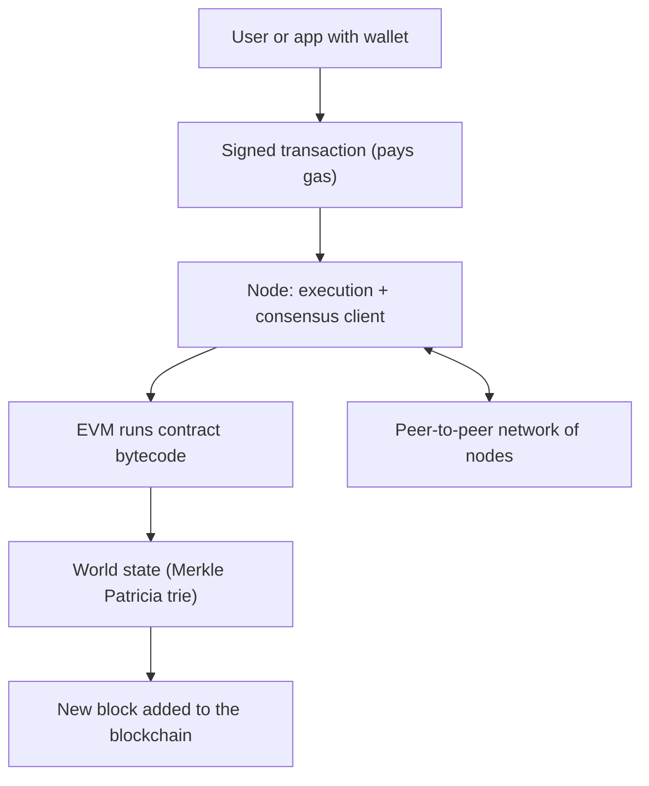

**In simple words:** Ethereum is a blockchain that can run programs, not just move coins. Think of it as one shared computer that thousands of nodes keep in step. Anyone can put a program (a smart contract) on it, and everyone can check that it ran correctly. <Cite id="ethereum-whitepaper" />

**Architecture (main components):** <Cite id="ethereum-gfg-components" />

1. **Accounts.** An *externally owned account* (EOA) is controlled by a private key. A *contract account* is controlled by its code. Each has an address, a balance and a nonce (count of sent transactions). <Cite id="ethereum-eth-accounts" />
2. **Transactions.** Signed messages from an EOA: send Ether, deploy a contract or call a contract function.
3. **EVM (Ethereum Virtual Machine).** Runs contract bytecode on every node, in the same way, in a sandbox. <Cite id="ethereum-eth-evm" />
4. **Gas.** The fee for computing work. Every step costs gas, which stops endless loops and pays validators.
5. **World state.** Maps every address to its account data, stored in a Merkle Patricia trie. Its root hash is in each block header.
6. **Blocks and chain.** Transactions are grouped into blocks, and each block holds the hash of the previous one.
7. **Nodes and network.** Peer-to-peer computers. Each runs an execution client (runs the EVM, holds state) and a consensus client (proof-of-stake agreement). <Cite id="ethereum-eth-nodes" />
8. **Consensus.** Proof of stake: validators lock 32 ETH, propose blocks and vote. Before September 2022 it was proof of work.

**Workflow, step by step:** <Cite id="ethereum-me-ch6" loc="Transaction Life Cycle" />

1. **Create and sign.** The wallet fills in recipient, value, data, gas limit and fees, then signs with the private key.
2. **Send.** The signed transaction goes to a node, which does a quick check and keeps it in its mempool (waiting list).
3. **Gossip.** The node passes it to peers, who check it and pass it on.
4. **Include.** The validator chosen for the next slot puts it in a block.
5. **Execute.** The EVM checks the signature and nonce, moves the value and runs contract code if needed. Every other node repeats this and compares the resulting state root.
6. **Settle.** Unused gas is refunded, the base fee is burned and the tip goes to the proposer. A receipt is stored.
7. **Finalise.** After about 12 minutes the block is final. <Cite id="ethereum-eth-stack" />

**Ethereum versus Bitcoin:** Bitcoin is mainly money with a limited script and uses UTXOs. Ethereum runs general programs and uses accounts.

**Conclusion:** accounts, transactions, the EVM, gas, state and a staking network together make Ethereum a programmable blockchain.
