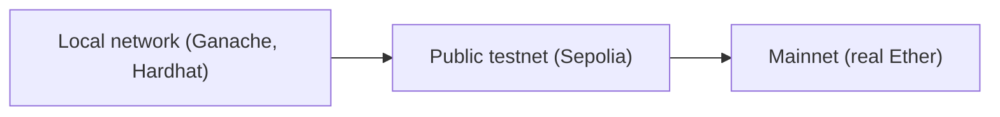

**In simple words:** test network (testnet) blockchain ki practice copy hai. Ye asli network jaisa kaam karta hai, par iske coins ki koi value nahi. Developer wahan free mein smart contract deploy karke test kar sakta hai aur galtiyan safely kar sakta hai. Asli network **mainnet** hai. <Cite id="ethereum-eth-networks" />

**Testnets kyun zaroori:** deploy hua contract badalna mushkil hai aur bugs se asli paisa ja sakta hai. Isliye code pehle testnet par try hota hai. Test Ether **faucet** se free milta hai (ek website jo test coins deti hai). <Cite id="ethereum-alchemy-testnets" />

**Test networks ke types:**

1. **Local (private) network.** Aapke apne computer par blockchain, jaise **Ganache** ya Hardhat ka built-in node. Blocks turant aur free hain, par sirf aap use karte ho. <Cite id="ethereum-tp-ganache" />
2. **Public testnets.** Khule networks jinme kai nodes judte hain aur jo mainnet jaise behave karte hain. Ye developers aur validators ke liye rakhe jaate hain.
3. **Developer networks (devnets).** Client teams ke banaye chhote time ke networks jo naye upgrades try karne ke liye hote hain.

**Public Ethereum testnets:**

| Testnet | Consensus | Status and use |
|---|---|---|
| Ropsten | Proof of work | Retired |
| Kovan | Proof of authority | Retired |
| Rinkeby | Proof of authority | Retired |
| Goerli | Proof of authority, then proof of stake after the 2022 Merge | Retired |
| Sepolia | Proof of stake | Current. Default for contract and app developers |
| Hoodi | Proof of stake | Current. For protocol developers and for people testing validators |

Ropsten, Kovan, Rinkeby aur Goerli purani books mein aate hain, to inhe jaano, par likho ki ab ye band ho chuke hain. **Proof of authority** matlab kuch named nodes par blocks banane ka bharosa hota hai: sasta aur tez, par kam decentralised. <Cite id="ethereum-consensys-testnets" /> <Cite id="consensus-mining-eth-poa" />

| Point | Mainnet | Testnet |
|---|---|---|
| Coin value | Real money | No value |
| Purpose | Live use | Testing and practice |
| How to get coins | Buy | Free from a faucet |
| Risk | Mistakes cost money | Safe to fail |

**Conclusion:** pehle local test karo, phir Sepolia jaise public testnet par, aur contract sahi chalne par hi mainnet par deploy karo.
