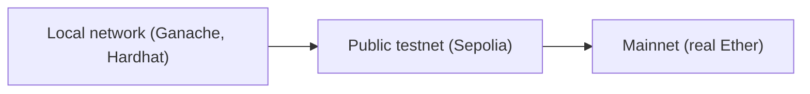

**In simple words:** a test network (testnet) is a practice copy of a blockchain. It works like the real network, but its coins have no value. A developer can deploy and test a smart contract there for free and make mistakes safely. The real network is the **mainnet**. <Cite id="ethereum-eth-networks" />

**Why testnets are needed:** a deployed contract is hard to change and bugs can cost real money. So the code is tried on a testnet first. Test Ether comes free from a **faucet** (a website that gives out test coins). <Cite id="ethereum-alchemy-testnets" />

**Types of test networks:**

1. **Local (private) network.** A blockchain on your own computer, such as **Ganache** or the built-in Hardhat node. Blocks are instant and free, but only you use it. <Cite id="ethereum-tp-ganache" />
2. **Public testnets.** Open networks that many nodes join and that behave like mainnet. They are kept for developers and validators.
3. **Developer networks (devnets).** Short-lived networks made by client teams to try new upgrades.

**Public Ethereum testnets:**

| Testnet | Consensus | Status and use |
|---|---|---|
| Ropsten | Proof of work | Retired |
| Kovan | Proof of authority | Retired |
| Rinkeby | Proof of authority | Retired |
| Goerli | Proof of authority, then proof of stake after the 2022 Merge | Retired |
| Sepolia | Proof of stake | Current. Default for contract and app developers |
| Hoodi | Proof of stake | Current. For protocol developers and for people testing validators |

Ropsten, Kovan, Rinkeby and Goerli appear in older books, so know them, but state that they are now shut down. **Proof of authority** means a few named nodes are trusted to make blocks: cheap and fast, but less decentralised. <Cite id="ethereum-consensys-testnets" /> <Cite id="consensus-mining-eth-poa" />

| Point | Mainnet | Testnet |
|---|---|---|
| Coin value | Real money | No value |
| Purpose | Live use | Testing and practice |
| How to get coins | Buy | Free from a faucet |
| Risk | Mistakes cost money | Safe to fail |

**Conclusion:** test locally first, then on a public testnet such as Sepolia, and deploy to mainnet only when the contract works.
