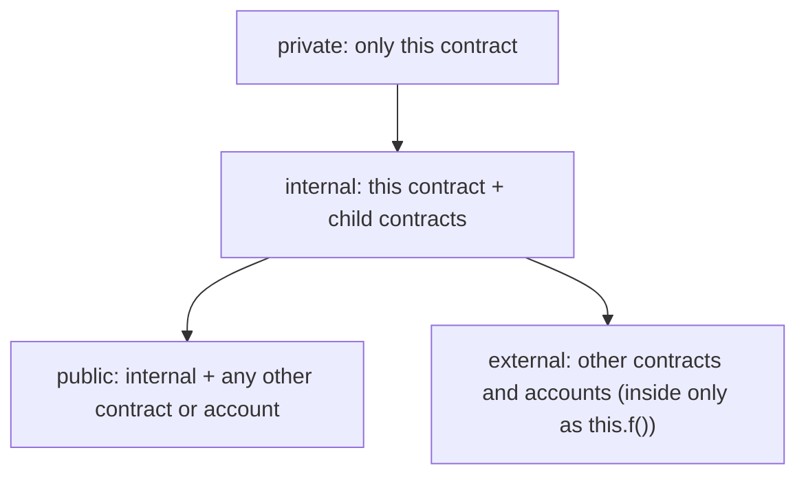

**In simple words:** visibility tay karti hai ki **function ko kaun call kar sakta hai** (ya state variable kaun padh sakta hai). Solidity mein chaar specifiers hain: `public`, `external`, `internal` aur `private`. Ghar socho: `public` front gate hai, `external` sirf mehmaanon ki doorbell hai, `internal` family ke kamre hain, aur `private` aapka apna kamra. <Cite id="solidity-docs-visibility" />

| Specifier | Inside this contract | Child contract | Other contracts and outside accounts |
|---|---|---|---|
| `public` | Yes | Yes | Yes |
| `external` | Only as `this.f()` | Only as `this.f()` | Yes |
| `internal` | Yes | Yes | No |
| `private` | Yes | No | No |

- `public` state variable ko free getter function milta hai. State variables `external` nahi ho sakte; unka default `internal` hai.
- `private` data ko chhupata nahi. Blockchain par sab kuch padha ja sakta hai, `private` sirf dusre contracts ko code mein use karne se rokta hai. <Cite id="solidity-gfg-visibility" />



```solidity
// SPDX-License-Identifier: MIT
pragma solidity ^0.8.0;

contract Bank {
    uint private secretCode = 1234;   // only Bank can use this
    uint internal rate = 5;           // Bank and its children
    uint public bankId = 7;           // anyone, with a free getter

    // public: callable from outside and from inside
    function getRate() public view returns (uint) {
        return rate;
    }

    // external: callable only from outside (or as this.f())
    function ping() external pure returns (string memory) {
        return "pong";
    }

    // internal: only this contract and its children
    function addInterest(uint amount) internal view returns (uint) {
        return amount + (amount * rate) / 100;
    }

    // private: only this contract
    function check(uint code) private view returns (bool) {
        return code == secretCode;
    }

    // public function that uses the internal and private ones
    function withInterest(uint amount, uint code) public view returns (uint) {
        require(check(code), "Wrong code");
        return addInterest(amount);
    }

    // calling an external function from inside needs this.
    function callPing() public view returns (string memory) {
        return this.ping();
    }
}

contract SavingsBank is Bank {
    // a child can use internal members, but not private ones
    function childInterest(uint amount) public view returns (uint) {
        return addInterest(amount) + rate;
    }
}
```

**Line by line, simple words mein:**

- `pragma solidity ^0.8.0;` kehta hai ki code ko compiler 0.8.0 ya naya 0.8.x chahiye. `SPDX` line sirf licence batati hai.
- `secretCode` `private` hai, `rate` `internal` hai, aur `bankId` `public` hai, isliye Solidity getter `bankId()` bana deta hai.
- `getRate` `public` hai, to koi user ya contract call kar sakta hai. `view` ka matlab wo sirf data padhta hai.
- `ping` `external` hai: sirf bahar se call ho sakta hai. `pure` ka matlab wo kuch padhta nahi.
- `addInterest` `internal` hai: amount mein `rate` percent jodta hai. Sirf `Bank` aur children call kar sakte hain.
- `check` `private` hai: sirf `Bank` use kar sakta hai. Wo code ko `secretCode` se compare karta hai.
- `withInterest` chhupe functions tak jaane ka public darwaza hai. Code galat ho to `require` call rok deta hai (message ke saath).
- `callPing` `external` function ko call karta hai, jiske liye aage `this.` lagana padta hai.
- `SavingsBank is Bank` ek child hai. Wo `addInterest` aur `rate` use kar sakta hai, par wahan `check(...)` ya `secretCode` likhne par compile error aata hai.

<Box kind="verify">

`SavingsBank` deploy karke call karo:

1. `getRate()` 5 deta hai, `bankId()` 7 deta hai aur `callPing()` "pong" deta hai.
2. `withInterest(200, 1234)` deta hai 200 + (200 x 5) / 100 = 210.
3. `withInterest(200, 1)` "Wrong code" ke saath fail hota hai.
4. `childInterest(200)` deta hai 210 + 5 = 215.
5. Remix mein `addInterest` ya `check` ke buttons nahi dikhte, kyunki wo `internal` aur `private` hain.

Maine ye code solc 0.8.26 se compile kiya aur koi error ya warning nahi aayi. Call ke results code se haath se nikale hain.

</Box>

**Conclusion:** sabse tang visibility use karo jo kaam kar jaye: helpers ke liye `private`, children ke liye `internal`, contract ke asli interface ke liye `public` ya `external`. <Cite id="solidity-mastering-ethereum-ch7" />
