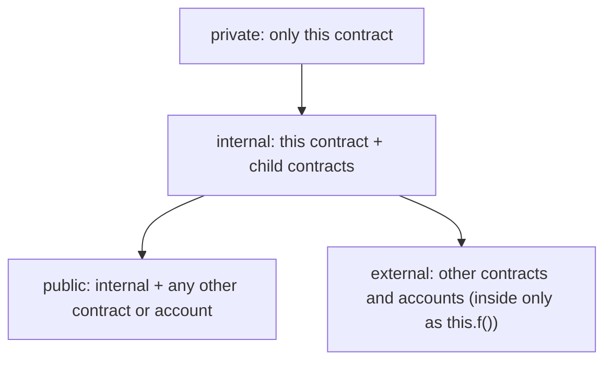

**In simple words:** visibility decides **who is allowed to call a function** (or read a state variable). Solidity has four specifiers: `public`, `external`, `internal` and `private`. Think of a house: `public` is the front gate, `external` is the doorbell for visitors only, `internal` is the family rooms, and `private` is your own room. <Cite id="solidity-docs-visibility" />

| Specifier | Inside this contract | Child contract | Other contracts and outside accounts |
|---|---|---|---|
| `public` | Yes | Yes | Yes |
| `external` | Only as `this.f()` | Only as `this.f()` | Yes |
| `internal` | Yes | Yes | No |
| `private` | Yes | No | No |

- A `public` state variable gets a free getter function. State variables cannot be `external`; their default is `internal`.
- `private` does not hide data. Everything on the blockchain can be read, so `private` only stops other contracts from using it in code. <Cite id="solidity-gfg-visibility" />



```solidity
// SPDX-License-Identifier: MIT
pragma solidity ^0.8.0;

contract Bank {
    uint private secretCode = 1234;   // only Bank can use this
    uint internal rate = 5;           // Bank and its children
    uint public bankId = 7;           // anyone, with a free getter

    // public: callable from outside and from inside
    function getRate() public view returns (uint) {
        return rate;
    }

    // external: callable only from outside (or as this.f())
    function ping() external pure returns (string memory) {
        return "pong";
    }

    // internal: only this contract and its children
    function addInterest(uint amount) internal view returns (uint) {
        return amount + (amount * rate) / 100;
    }

    // private: only this contract
    function check(uint code) private view returns (bool) {
        return code == secretCode;
    }

    // public function that uses the internal and private ones
    function withInterest(uint amount, uint code) public view returns (uint) {
        require(check(code), "Wrong code");
        return addInterest(amount);
    }

    // calling an external function from inside needs this.
    function callPing() public view returns (string memory) {
        return this.ping();
    }
}

contract SavingsBank is Bank {
    // a child can use internal members, but not private ones
    function childInterest(uint amount) public view returns (uint) {
        return addInterest(amount) + rate;
    }
}
```

**Line by line, in simple words:**

- `pragma solidity ^0.8.0;` says the code needs compiler 0.8.0 or a newer 0.8.x. The `SPDX` line only states the licence.
- `secretCode` is `private`, `rate` is `internal`, and `bankId` is `public`, so Solidity makes a getter `bankId()`.
- `getRate` is `public`, so a user or any contract can call it. `view` means it only reads data.
- `ping` is `external`: callable only from outside. `pure` means it reads nothing.
- `addInterest` is `internal`: it adds `rate` percent to the amount. Only `Bank` and children can call it.
- `check` is `private`: only `Bank` can use it. It compares the code with `secretCode`.
- `withInterest` is a public door into the hidden functions. `require` stops the call (with the message) if the code is wrong.
- `callPing` calls the `external` function, which needs `this.` in front.
- `SavingsBank is Bank` is a child. It may use `addInterest` and `rate`, but writing `check(...)` or `secretCode` there gives a compile error.

<Box kind="verify">

Deploy `SavingsBank` and call:

1. `getRate()` returns 5, `bankId()` returns 7 and `callPing()` returns "pong".
2. `withInterest(200, 1234)` returns 200 + (200 x 5) / 100 = 210.
3. `withInterest(200, 1)` fails with "Wrong code".
4. `childInterest(200)` returns 210 + 5 = 215.
5. Remix shows no buttons for `addInterest` or `check`, because they are `internal` and `private`.

I compiled this code with solc 0.8.26 and it gave no errors or warnings. The call results are worked out by hand from the code.

</Box>

**Conclusion:** use the narrowest visibility that works: `private` for helpers, `internal` for what children need, `public` or `external` for the contract's real interface. <Cite id="solidity-mastering-ethereum-ch7" />
