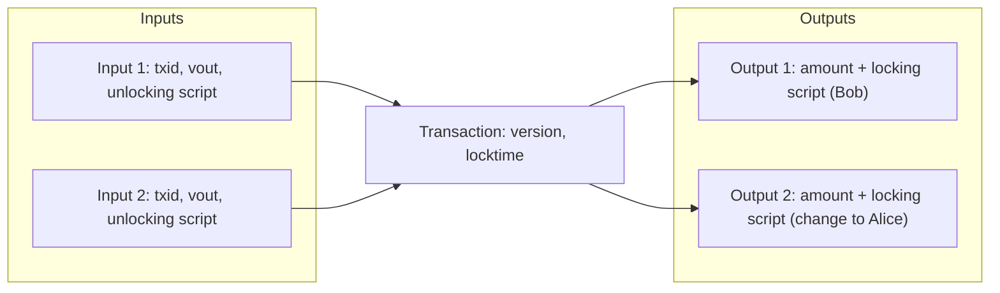
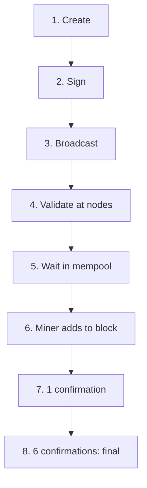

**In simple words:** Bitcoin transaction ye nahi kehta ki "Alice ke account se Bob ke account mein coins bhejo". Bitcoin mein accounts nahi hote. Transaction **purane outputs kharch karta hai aur naye outputs banata hai**. Jo output abhi kharch nahi hua wo UTXO hai. <Cite id="bitcoin-btcwiki-transaction" />

**Transaction structure:**

| Field | Meaning |
|---|---|
| Version | Which transaction rules apply |
| Inputs | Each points to an earlier output (by `txid` and output number `vout`) and carries the unlocking script (signature and public key) |
| Outputs | Each has an amount (in satoshis) and a locking script that says who can spend it |
| Witness (SegWit) | Signatures kept in a separate section |
| Locktime | Earliest time or block when the transaction may be mined (0 means any time) |

**Fee** koi field nahi hai. Ye bacha hua hissa hai: fee = inputs ka sum - outputs ka sum. Har block ka pehla transaction **coinbase transaction** hota hai, jisme asli input nahi hota aur wo block reward banata hai. <Cite id="bitcoin-mb-ch06-transactions" />

**Transaction life cycle:**

1. **Create.** Alice ka wallet kharch karne ke liye UTXOs chunta hai, outputs likhta hai (payment aur change) aur fee set karta hai.
2. **Sign.** Har input ke liye wallet usi private key se sign karta hai jo use unlock karti hai. Baad mein amount badalne se signature toot jaata hai.
3. **Broadcast.** Wallet use ek node ko bhejta hai.
4. **Validate.** Har node format check karta hai, ki inputs maujood aur unspent hain, scripts true dete hain, aur inputs kam se kam outputs jitne hain. <Cite id="bitcoin-mb-ch12-mining" loc="Independent Verification of Transactions" />
5. **Propagate.** Valid transactions peers ko forward hote hain aur har node ki **mempool** mein wait karte hain. <Cite id="bitcoin-mb-ch10-network" loc="Mempools and Orphan Pools" />
6. **Mine.** Miner use candidate block mein daalta hai, aam taur par size ke hisaab se zyada fee wale pehle.
7. **Confirm.** Block accept hone par transaction ko 1 confirmation milta hai. Har agla block ek aur jodta hai.
8. **Final.** Lagbhag 6 confirmations (kareeb ek ghanta) ke baad ise ulatna practically namumkin hai. <Cite id="bitcoin-og-tx-lifecycle" />

**Example:** Alice ke paas 0.5 aur 0.3 BTC ke UTXOs hain aur wo Bob ko 0.6 BTC deti hai, fee 0.0001. Inputs = 0.8. Change = 0.8 - 0.6 - 0.0001 = 0.1999. Check: 0.6 + 0.1999 + 0.0001 = 0.8, jo inputs ke barabar hai.

**Conclusion:** transaction inputs aur outputs ka signed set hai, jise har node check karta hai, aur mining aur confirmations use final banate hain.
