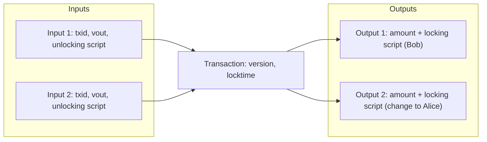
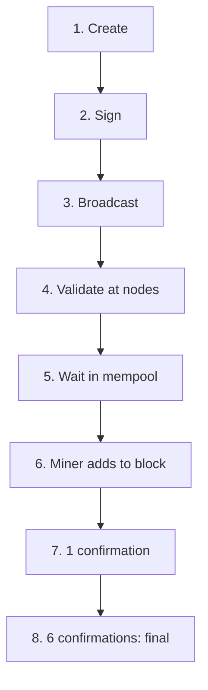

**In simple words:** a Bitcoin transaction does not say "move coins from Alice's account to Bob's". Bitcoin has no accounts. A transaction **spends earlier outputs and creates new outputs**. An unspent output is a UTXO. <Cite id="bitcoin-btcwiki-transaction" />

**Transaction structure:**

| Field | Meaning |
|---|---|
| Version | Which transaction rules apply |
| Inputs | Each points to an earlier output (by `txid` and output number `vout`) and carries the unlocking script (signature and public key) |
| Outputs | Each has an amount (in satoshis) and a locking script that says who can spend it |
| Witness (SegWit) | Signatures kept in a separate section |
| Locktime | Earliest time or block when the transaction may be mined (0 means any time) |

The **fee** is not a field. It is the leftover: fee = sum of inputs - sum of outputs. The first transaction in each block is the **coinbase transaction**, which has no real input and creates the block reward. <Cite id="bitcoin-mb-ch06-transactions" />

**Transaction life cycle:**

1. **Create.** Alice's wallet picks UTXOs to spend, writes the outputs (payment and change) and sets the fee.
2. **Sign.** For each input, the wallet signs with the private key that unlocks it. Changing the amount later would break the signature.
3. **Broadcast.** The wallet sends it to a node.
4. **Validate.** Each node checks the format, that inputs exist and are unspent, that scripts return true, and that inputs are at least outputs. <Cite id="bitcoin-mb-ch12-mining" loc="Independent Verification of Transactions" />
5. **Propagate.** Valid transactions are forwarded to peers and wait in each node's **mempool**. <Cite id="bitcoin-mb-ch10-network" loc="Mempools and Orphan Pools" />
6. **Mine.** A miner picks it into a candidate block, usually preferring higher fee per size.
7. **Confirm.** When the block is accepted, the transaction has 1 confirmation. Each later block adds one.
8. **Final.** About 6 confirmations (roughly an hour) make reversal practically impossible. <Cite id="bitcoin-og-tx-lifecycle" />

**Example:** Alice has UTXOs of 0.5 and 0.3 BTC and pays Bob 0.6 BTC with a fee of 0.0001. Inputs = 0.8. Change = 0.8 - 0.6 - 0.0001 = 0.1999. Check: 0.6 + 0.1999 + 0.0001 = 0.8, equal to the inputs.

**Conclusion:** a transaction is a signed set of inputs and outputs, checked by every node, and made final by mining and confirmations.
