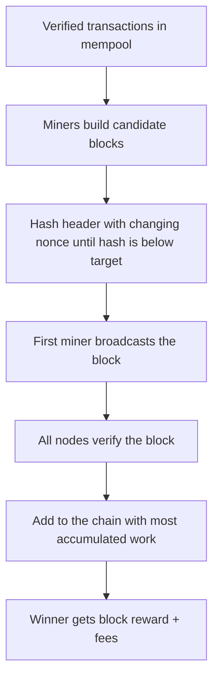

**In simple words:** consensus matlab hazaaron computers jo ek dusre par bharosa nahi karte, bina kisi leader ke ledger ke ek version par agree karte hain. Bitcoin ye **proof of work** se karta hai, is method ko **Nakamoto consensus** kehte hain. <Cite id="blockchain-fundamentals-nakamoto" loc="§5" />

**Kyun zaroori:** bank ke bina network ko tay karna padta hai ki kaun se transactions valid hain aur kis order mein, warna ek coin do baar kharch ho sakta hai (double spending).

**Kaise kaam karta hai:**

1. Har full node har transaction ko rules ke against **independently verify** karta hai.
2. **Miners** valid transactions ko candidate block mein jama karte hain.
3. Miner block header ko alag alag nonce ke saath baar baar hash karta hai jab tak hash network target se chhota na ho. Ye proof of work hai. <Cite id="consensus-mining-gfg-pow" />
4. Jo miner pehle succeed hota hai wo block broadcast karta hai aur block reward aur fees kamata hai.
5. Baaki nodes block verify karke use us chain mein jodte hain jisme **sabse zyada accumulated work** hai (aam taur par longest chain kehte hain). <Cite id="bitcoin-mb-ch12-mining" />
6. Do miners lagbhag ek saath block dhoondhen to chain thodi der ke liye fork hoti hai. Jab agla block ek branch par aata hai, dusri branch **orphan** (stale) block ban jaati hai aur uske transactions mempool mein wapas aate hain.
7. Jo block aur blocks ke neeche dab jaata hai use badalna exponentially mushkil hota hai. Lagbhag 6 confirmations final maane jaate hain. <Cite id="consensus-mining-btcwiki-confirmation" />

**Difficulty:** har 2016 blocks par target adjust hota hai taaki lagbhag har 10 minute mein ek block mile.

**Security:** recent history badalne ke liye attacker ko network ki aadhi se zyada hash power chahiye (**51% attack**). Tab bhi private keys ke bina coins churaye nahi ja sakte. <Cite id="consensus-mining-btcwiki-majority" />

| Strength | Weakness |
|---|---|
| Open to anyone, no trust needed | Huge electricity use |
| Very secure for big networks | Slow: about 10 minutes per block |
| Simple rule: most work wins | Mining pools concentrate power |

**Conclusion:** Bitcoin block banana mehenga (work) aur block check karna sasta banakar agreement paata hai, isliye honest majority hash power ek consistent ledger rakhti hai.
