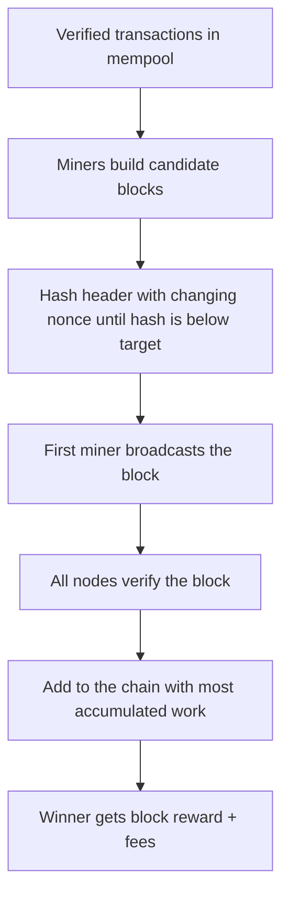

**In simple words:** consensus means thousands of computers that do not trust each other agree on one version of the ledger, with no leader. Bitcoin does this with **proof of work**, a method called **Nakamoto consensus**. <Cite id="blockchain-fundamentals-nakamoto" loc="§5" />

**Why it is needed:** without a bank, the network must decide which transactions are valid and in what order, otherwise one coin could be spent twice (double spending).

**How it works:**

1. Every full node **independently verifies** each transaction against the rules.
2. **Miners** collect valid transactions into a candidate block.
3. A miner repeatedly hashes the block header with different nonces until the hash is below the network target. This is the proof of work. <Cite id="consensus-mining-gfg-pow" />
4. The first miner to succeed broadcasts the block and earns the block reward and fees.
5. Other nodes verify the block and add it to the chain with the **most accumulated work** (usually called the longest chain). <Cite id="bitcoin-mb-ch12-mining" />
6. If two miners find a block at almost the same time, the chain forks for a short while. When the next block lands on one branch, the other becomes an **orphan** (stale) block and its transactions return to the mempool.
7. A block buried under more blocks is exponentially harder to replace. About 6 confirmations are treated as final. <Cite id="consensus-mining-btcwiki-confirmation" />

**Difficulty:** every 2016 blocks the target is adjusted so a block is found about every 10 minutes.

**Security:** an attacker would need more than half of the network's hash power (a **51% attack**) to rewrite recent history. Even then, coins cannot be stolen without private keys. <Cite id="consensus-mining-btcwiki-majority" />

| Strength | Weakness |
|---|---|
| Open to anyone, no trust needed | Huge electricity use |
| Very secure for big networks | Slow: about 10 minutes per block |
| Simple rule: most work wins | Mining pools concentrate power |

**Conclusion:** Bitcoin reaches agreement by making block creation costly (work) and block checking cheap, so honest majority hash power keeps one consistent ledger.
