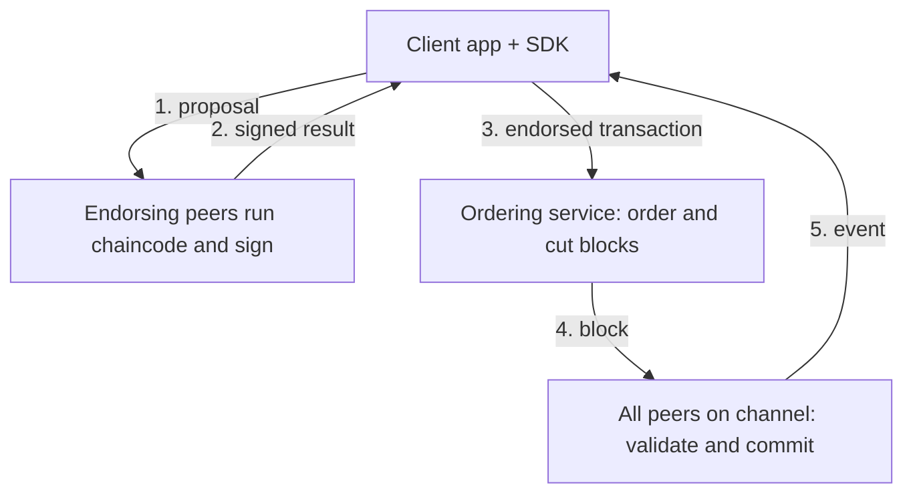

**In simple words:** Hyperledger Fabric businesses ke liye open-source, **permissioned** blockchain platform hai, jise Linux Foundation host karta hai. Sirf known, approved organizations hissa leti hain. Mining nahi hoti aur built-in coin nahi hota. Ise company office samjho jahan andar jaane ke liye ID card chahiye, public park ke ulta. <Cite id="hyperledger-fabric-whatis" />

**Kyun zaroori:** banks aur suppliers jaisi companies ledger share karna chahti hain, par sirf chune hue partners ke saath, privacy aur speed ke saath. Public chains khuli aur dheemi hain, isliye Fabric ye gap bharta hai. <Cite id="hyperledger-fabric-ibm-fabric" />

**Main features:** permissioned aur identity-based, modular (consensus aur identity badle ja sakte hain), private channels, normal languages mein chaincode (Go, Java, JavaScript), aur cryptocurrency ki zaroorat nahi.

**Architecture (Fabric v1):** <Cite id="hyperledger-fabric-network" />

- **Clients** (SDK use karne wale apps) transactions propose karte hain.
- **Peers** ledger rakhte hain aur chaincode (smart contract) chalate hain. *Endorsing* peers chalate aur sign karte hain; har peer *commit* karta hai.
- **Ordering service** transactions ko har channel ke liye ek order mein rakhti hai aur blocks banati hai. Wo contents nahi padhti. <Cite id="hyperledger-fabric-ordering" />
- **Fabric CA aur MSP** identities dete hain aur tay karte hain ki har ek kya kar sakta hai.
- **Channels** private sub-networks hain, har ek ka apna ledger.
- **Ledger** mein blockchain (blocks ka log) aur world state (current values) hoti hai.

**Execute, order, validate:** purani blockchains pehle order karti hain aur phir har node har transaction chalata hai. Fabric transaction sirf endorsing peers par chalata hai, phir order karta hai, aur har peer aakhir mein **endorsement policy** aur read-set versions check karke commit karta hai. <Cite id="hyperledger-fabric-txflow" />

| Advantages | Limitations |
|---|---|
| Private and permissioned | Not fully decentralised |
| Fast, no mining | Needs setup and trusted members |
| Flexible, modular | Complex to run |
| Standard languages | Smaller community than Ethereum |

**Applications:** supply chain, trade finance, healthcare records aur land records. <Cite id="hyperledger-fabric-gfg-fabric" />

**Conclusion:** Fabric modular, permissioned blockchain hai jo channels aur execute-order-validate design se businesses ko privacy aur speed deti hai.
