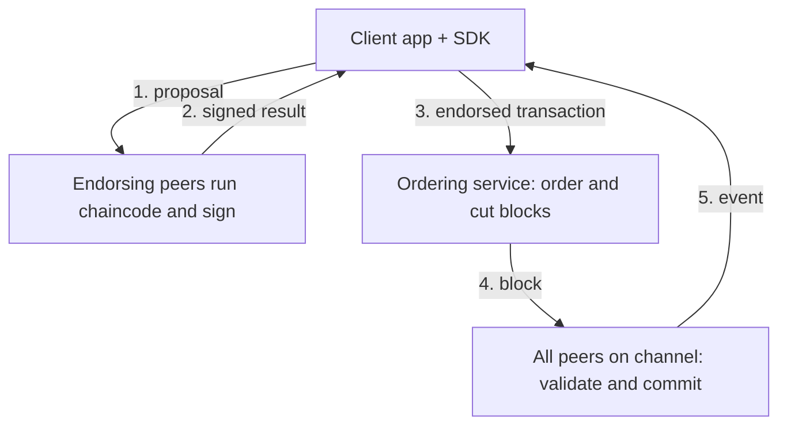

**In simple words:** Hyperledger Fabric is an open-source, **permissioned** blockchain platform for businesses, hosted by the Linux Foundation. Only known, approved organizations take part. There is no mining and no built-in coin. Think of it as a company office where you need an ID card to enter, unlike a public park. <Cite id="hyperledger-fabric-whatis" />

**Why it is needed:** companies such as banks and suppliers want to share a ledger, but only with chosen partners, with privacy and speed. Public chains are open and slow, so Fabric fills this gap. <Cite id="hyperledger-fabric-ibm-fabric" />

**Main features:** permissioned and identity-based, modular (consensus and identity can be swapped), private channels, chaincode in ordinary languages (Go, Java, JavaScript), and no cryptocurrency needed.

**Architecture (Fabric v1):** <Cite id="hyperledger-fabric-network" />

- **Clients** (apps using an SDK) propose transactions.
- **Peers** hold the ledger and run chaincode (the smart contract). *Endorsing* peers run and sign; every peer *commits*.
- **Ordering service** puts transactions in one order per channel and cuts blocks. It does not read the contents. <Cite id="hyperledger-fabric-ordering" />
- **Fabric CA and MSP** give identities and decide what each may do.
- **Channels** are private sub-networks, each with its own ledger.
- **Ledger** has the blockchain (log of blocks) and the world state (current values).

**Execute, order, validate:** older blockchains order first and then every node runs every transaction. Fabric runs a transaction only on the endorsing peers, then orders, and every peer finally checks the **endorsement policy** and the read-set versions before committing. <Cite id="hyperledger-fabric-txflow" />

| Advantages | Limitations |
|---|---|
| Private and permissioned | Not fully decentralised |
| Fast, no mining | Needs setup and trusted members |
| Flexible, modular | Complex to run |
| Standard languages | Smaller community than Ethereum |

**Applications:** supply chain, trade finance, healthcare records and land records. <Cite id="hyperledger-fabric-gfg-fabric" />

**Conclusion:** Fabric is a modular, permissioned blockchain that gives businesses privacy and speed through channels and the execute-order-validate design.
