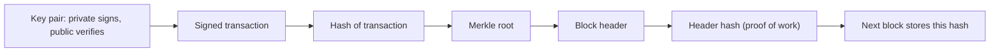

**In simple words:** cryptography data ko safe rakhne aur uske asli hone ka proof dene ka science hai. Blockchain kuch cryptographic tools se bani hai. Ye milkar use tamper-evident banate hain aur bina bank ke logon ko coins ka owner banne dete hain. <Cite id="block-structure-merkle-me-ch4" />

**1. Cryptographic hash function.** Ye kisi bhi data ko fixed-size fingerprint banata hai (Bitcoin mein SHA-256, Ethereum mein Keccak-256). Ye one-way hai (hash se data wapas nahi milta), zara sa change bilkul alag hash deta hai, aur same hash wale do inputs dhoondhna infeasible hai. <Cite id="block-structure-merkle-wiki-hash" />

Uses: block header hash, pichhle block se link, proof-of-work puzzle, Merkle tree aur addresses. Analogy: parcel par tamper seal.

**2. Public-key cryptography.** Har user ke paas key pair hota hai: **private key** jo secret rehti hai aur **public key** jo sabke saath share hoti hai. Ek se doosri nikaalna mumkin nahi. Bitcoin elliptic curve keys use karta hai. Address public key se banta hai. <Cite id="block-structure-merkle-wiki-pubkey" /> <Cite id="bitcoin-mb-ch04-keys" />

**3. Digital signature.** Owner private key se transaction sign karta hai. Koi bhi public key se check kar sakta hai. Ye **authentication** (owner ne approve kiya), **integrity** (badla nahi gaya) aur **non-repudiation** (owner mukar nahi sakta) deta hai. Analogy: cheque par aapke signature. <Cite id="block-structure-merkle-wiki-digsig" />

**4. Merkle tree.** Transaction hashes ko jodi mein hash karte hain, level by level, ek **Merkle root** tak jo block header mein store hota hai. Kisi bhi transaction mein change root badal deta hai. Ye chhota proof bhi deta hai ki transaction block mein hai. <Cite id="block-structure-merkle-gfg-merkle" />

| Tool | What it gives | Where used |
|---|---|---|
| Hash | Integrity, tamper evidence | Blocks, PoW, Merkle tree, addresses |
| Key pair | Ownership without sharing a secret | Wallets and addresses |
| Signature | Authentication, non-repudiation | Every transaction |
| Merkle tree | One hash for many items, short proofs | Block header |

**Zaroori baat:** hashing encryption nahi hai. Hash se kuch chhupta nahi. Bitcoin transactions public aur padhne laayak hain; yahan cryptography proof aur integrity ke liye hai, secrecy ke liye nahi.

**Conclusion:** hashes blocks ko link karte hain, signatures ownership prove karte hain, aur Merkle trees transactions ka saar dete hain, isliye blockchain bina central authority ke secure hai.
