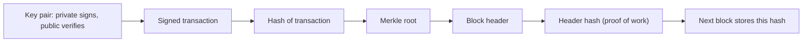

**In simple words:** cryptography is the science of keeping data safe and proving it is genuine. A blockchain is built from a few cryptographic tools. Together they make it tamper-evident and let people own coins without a bank. <Cite id="block-structure-merkle-me-ch4" />

**1. Cryptographic hash function.** It turns any data into a fixed-size fingerprint (SHA-256 in Bitcoin, Keccak-256 in Ethereum). It is one-way (you cannot get the data back), any tiny change gives a very different hash, and finding two inputs with the same hash is infeasible. <Cite id="block-structure-merkle-wiki-hash" />

Uses: block header hash, the link to the previous block, the proof-of-work puzzle, Merkle tree and addresses. Analogy: the tamper seal on a parcel.

**2. Public-key cryptography.** Each user has a key pair: a **private key** kept secret and a **public key** shared with all. One cannot be worked out from the other. Bitcoin uses elliptic curve keys. The address is made from the public key. <Cite id="block-structure-merkle-wiki-pubkey" /> <Cite id="bitcoin-mb-ch04-keys" />

**3. Digital signature.** The owner signs a transaction with the private key. Anyone can check it with the public key. It proves **authentication** (the owner approved it), **integrity** (not changed) and **non-repudiation** (the owner cannot deny it). Analogy: your signature on a cheque. <Cite id="block-structure-merkle-wiki-digsig" />

**4. Merkle tree.** Transaction hashes are paired and hashed again, level by level, up to one **Merkle root** stored in the block header. Any change in any transaction changes the root. It also allows a short proof that a transaction is in a block. <Cite id="block-structure-merkle-gfg-merkle" />

| Tool | What it gives | Where used |
|---|---|---|
| Hash | Integrity, tamper evidence | Blocks, PoW, Merkle tree, addresses |
| Key pair | Ownership without sharing a secret | Wallets and addresses |
| Signature | Authentication, non-repudiation | Every transaction |
| Merkle tree | One hash for many items, short proofs | Block header |

**Important point:** hashing is not encryption. Nothing is hidden by a hash. Bitcoin transactions are public and readable; cryptography is used here for proof and integrity, not secrecy.

**Conclusion:** hashes link the blocks, signatures prove ownership, and Merkle trees summarise transactions, so a blockchain is secure without a central authority.
