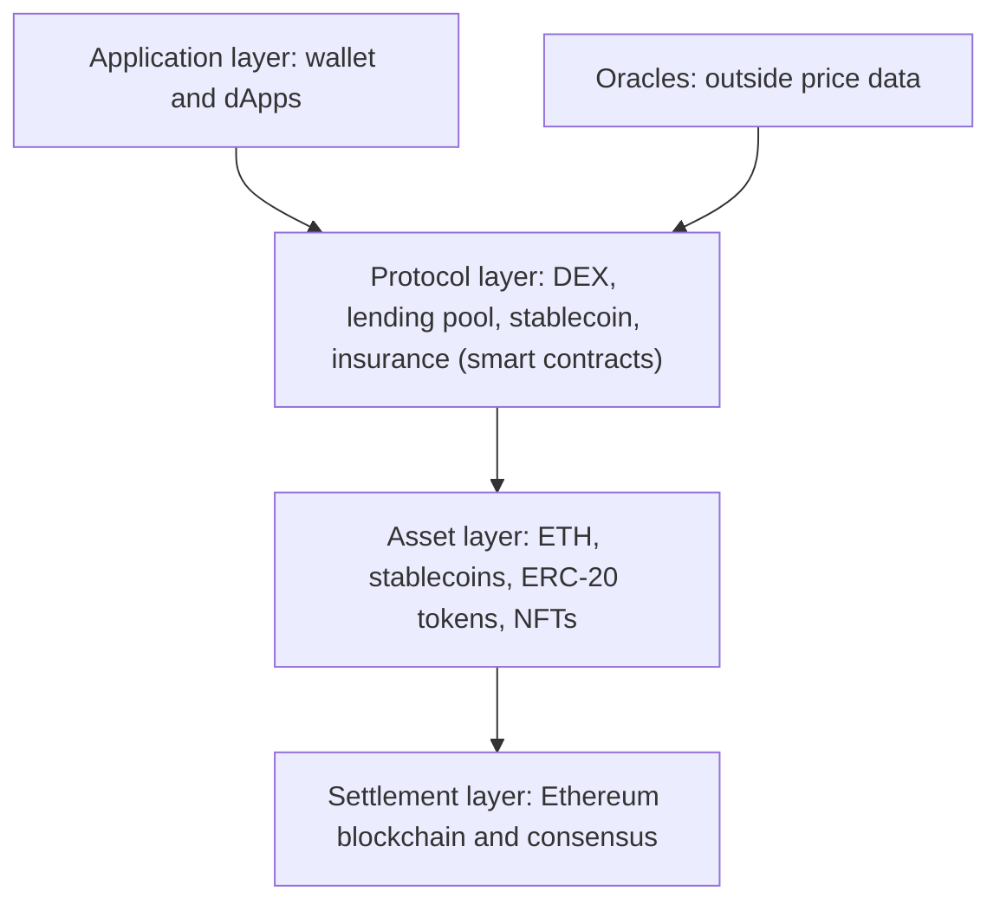

**In simple words:** DeFi (decentralised finance) bina bank ki banking hai. Lending, borrowing, trading aur saving jaisi services public blockchain, mostly Ethereum, par **smart contracts** chalate hain. Wallet aur internet wala koi bhi use kar sakta hai. <Cite id="blockchain-applications-ethereum-org-defi" />

**Kyun zaroori:** traditional finance un institutions par tiki hai jo aapka paisa rakhti hain, tay time par kaam karti hain, paperwork maangti hain aur settle hone mein din lagate hain. DeFi institution ki jagah aisa code rakhta hai jise koi bhi inspect kar sakta hai.

**Architecture:** DeFi layers mein bana hai, aur har layer ko upar wali layers reuse kar sakti hain, isliye logon ne pieces ko "money Legos" kaha. <Cite id="smart-contracts-wiki-defi" />

1. **Settlement layer.** Base blockchain (Ethereum) aur uska consensus. Ye transactions record karti hai aur final state rakhti hai.
2. **Asset layer.** Jo tokens move hote hain: ETH, stablecoins (steady price wale tokens, jaise DAI ya USDC), ERC-20 tokens aur NFTs. <Cite id="cryptocurrencies-tokens-wiki-stablecoin" />
3. **Protocol layer.** Smart contracts jo services dete hain: decentralised exchanges (DEX, jaise Uniswap), lending pools (Aave, Compound), stablecoin aur insurance protocols.
4. **Application layer.** Websites aur dApps jo users kholte hain, aur wallet (jaise MetaMask) jo transactions sign karta hai. <Cite id="smart-contracts-eth-defi" />

Ye bhi use hote hain: **oracles**, jo bahar ka data, jaise prices, chain par laate hain.

**Example, lending:** lender lending contract mein tokens jama karke interest kamata hai. Borrower loan se zyada collateral lock karta hai, aur contract tokens lend karta hai. Collateral ki value bahut gir jaye to contract use bech deta hai (liquidation). Isme na bank hai na credit check.

| Benefits | Risks |
|---|---|
| Open to anyone, works 24x7 | Contract bugs and hacks |
| You keep your own keys | Price swings and liquidation |
| Public, auditable code | Scams, unclear regulation |
| Fast settlement, fewer fees | Transactions cannot be undone |

<Cite id="blockchain-applications-gfg-beyond-crypto" />

**Conclusion:** DeFi settlement, assets, protocols aur apps ko stack karta hai taaki smart contracts banks ki jagah lein; faayda openness hai, aur keemat code ka risk hai.
