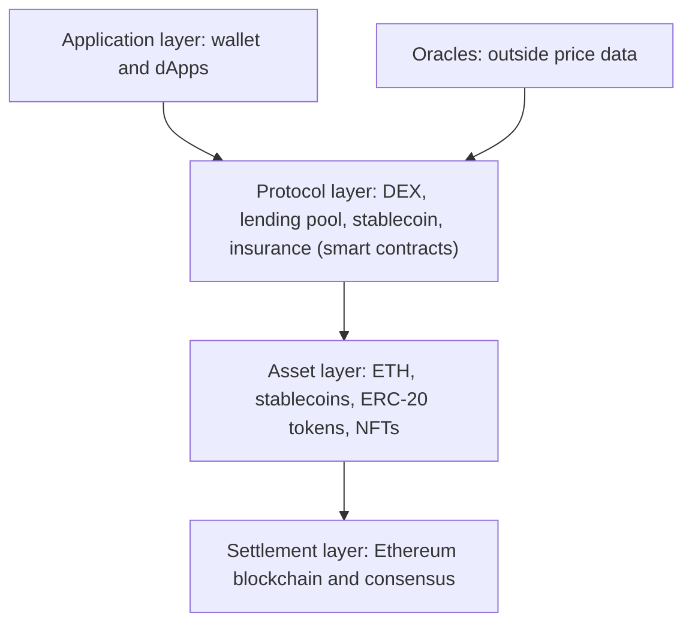

**In simple words:** DeFi (decentralised finance) is banking without a bank. Services like lending, borrowing, trading and saving are run by **smart contracts** on a public blockchain, mostly Ethereum. Anyone with a wallet and internet can use them. <Cite id="blockchain-applications-ethereum-org-defi" />

**Why it is needed:** traditional finance depends on institutions that hold your money, work set hours, ask for paperwork and take days to settle. DeFi replaces the institution with code anyone can inspect.

**Architecture:** DeFi is built in layers, and each layer can be reused by the ones above, which is why people call the pieces "money Legos". <Cite id="smart-contracts-wiki-defi" />

1. **Settlement layer.** The base blockchain (Ethereum) and its consensus. It records transactions and keeps the final state.
2. **Asset layer.** The tokens that move: ETH, stablecoins (tokens with a steady price, such as DAI or USDC), ERC-20 tokens and NFTs. <Cite id="cryptocurrencies-tokens-wiki-stablecoin" />
3. **Protocol layer.** Smart contracts that give the services: decentralised exchanges (DEX, e.g. Uniswap), lending pools (Aave, Compound), stablecoin and insurance protocols.
4. **Application layer.** The websites and dApps that users open, plus the wallet (e.g. MetaMask) that signs transactions. <Cite id="smart-contracts-eth-defi" />

Also used: **oracles**, which bring outside data such as prices onto the chain.

**Example, lending:** a lender deposits tokens in the lending contract and earns interest. A borrower locks more collateral than the loan, and the contract lends the tokens. If the collateral value falls too far, the contract sells it (liquidation). No bank or credit check is involved.

| Benefits | Risks |
|---|---|
| Open to anyone, works 24x7 | Contract bugs and hacks |
| You keep your own keys | Price swings and liquidation |
| Public, auditable code | Scams, unclear regulation |
| Fast settlement, fewer fees | Transactions cannot be undone |

<Cite id="blockchain-applications-gfg-beyond-crypto" />

**Conclusion:** DeFi stacks settlement, assets, protocols and apps so that smart contracts replace banks, with openness as the gain and code risk as the cost.
