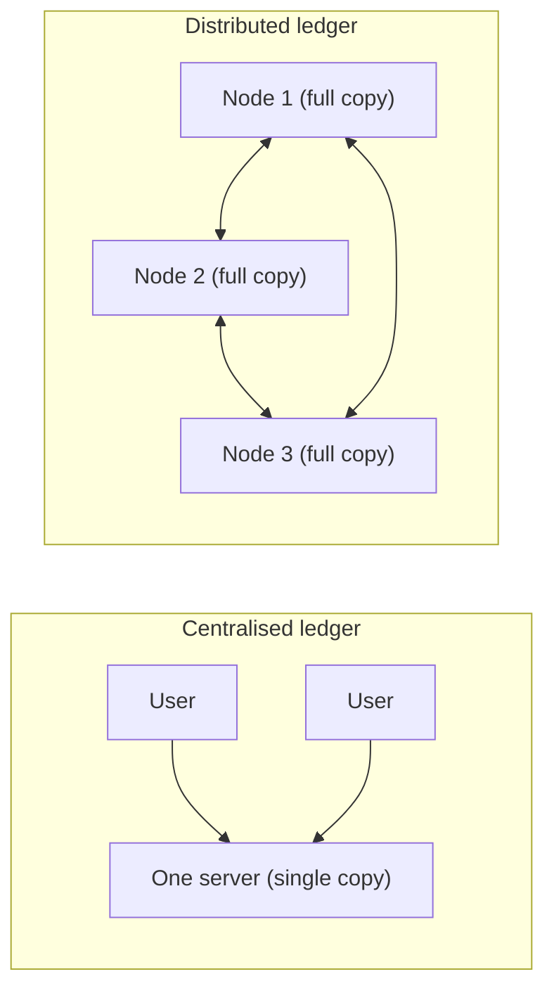

**In simple words:** distributed ledger ek record book (ledger) hai jo bahut saare computers ek saath rakhte hain. Koi ek master copy nahi hoti. Har participant ke paas apni copy hoti hai, aur agreed rules saari copies ko same rakhte hain. <Cite id="blockchain-fundamentals-wiki-dlt" />

**Definition:** distributed ledger ek database hai jo alag-alag jagah ke bahut saare nodes (computers) pe shared, copied aur synchronised rehta hai, bina kisi central administrator ke. Blockchain ek type ka distributed ledger hai, jisme records blocks mein group hote hain aur hashes se chain ki tarah jude hote hain. <Cite id="blockchain-fundamentals-ibm-blockchain" />

**Blockchain mein distributed ledger ki need:**

1. **No single point of failure.** Ek node crash ho jaye to baaki nodes ke paas poora data rehta hai.
2. **Ek party pe trust nahi karna padta.** Purane tareeke mein bank ya government book rakhti hai aur hum us pe bharosa karte hain. Yahan koi bhi data khud check kar sakta hai.
3. **Tamper resistance.** Record badalne ke liye attacker ko zyadatar copies ek saath badalni padengi, jo bahut mushkil hai. <Cite id="blockchain-fundamentals-nakamoto" />
4. **Transparency aur audit.** Sab participants same history dekhte hain, to disputes aasani se solve hote hain.
5. **Double spending rokta hai.** Saare nodes transactions ke ek order pe agree karte hain, to wahi coin do baar kharch nahi ho sakta (Bitcoin ki main problem).

**Example:** Bitcoin ka ledger duniya bhar ke hazaaron nodes pe copy hota hai, aur har node har payment khud verify kar sakta hai. <Cite id="blockchain-fundamentals-gfg-intro" />

**Conclusion:** distributed ledger middleman hata deta hai, kyunki record shared, verifiable aur badalne mein mushkil ho jaata hai.
