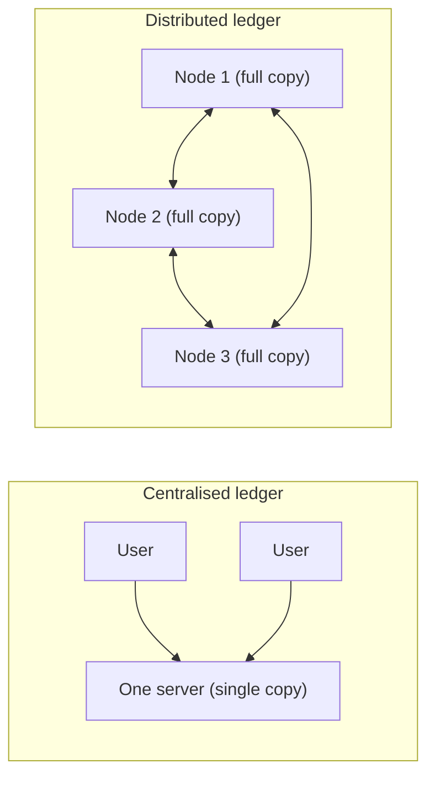

**In simple words:** a distributed ledger is a record book (ledger) that many computers keep at the same time. There is no single master copy. Every participant holds a copy, and all copies are kept the same by a set of agreed rules. <Cite id="blockchain-fundamentals-wiki-dlt" />

**Definition:** a distributed ledger is a database that is shared, copied and synchronised across many nodes (computers) in different places, with no central administrator. A blockchain is one kind of distributed ledger, in which the records are grouped in blocks and chained together by hashes. <Cite id="blockchain-fundamentals-ibm-blockchain" />

**Need of a distributed ledger in blockchain:**

1. **No single point of failure.** If one node crashes, the other nodes still hold the full data.
2. **No need to trust one party.** In the old way, a bank or a government keeps the book and we trust it. Here, anyone can check the data themselves.
3. **Tamper resistance.** To change a record, an attacker has to change it on most of the copies at once, which is very hard. <Cite id="blockchain-fundamentals-nakamoto" />
4. **Transparency and audit.** All participants see the same history, so disputes are easy to settle.
5. **Stops double spending.** All nodes agree on one order of transactions, so the same coin cannot be spent twice (Bitcoin's main problem).

**Example:** Bitcoin's ledger is copied on thousands of nodes worldwide, and each node can verify every payment itself. <Cite id="blockchain-fundamentals-gfg-intro" />

**Conclusion:** the distributed ledger removes the middleman by making the record shared, verifiable and hard to change.
