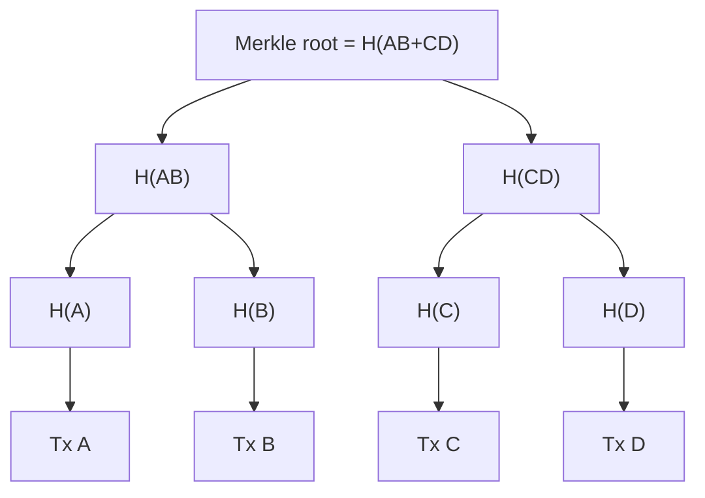

**In simple words:** Merkle tree hashes ka ek tree hai. Isse hum transactions ki bahut badi list ko sirf ek chhote hash, yaani top ke **Merkle root**, ko compare karke check kar sakte hain. <Cite id="block-structure-merkle-wiki-merkle" />

**Definition:** Merkle tree ek binary tree hai jisme har leaf ek data item (transaction) ka hash hota hai aur har parent node apne do children ko jodkar unka hash hota hai. Top ka single hash Merkle root hai, jo block header mein store hota hai. <Cite id="block-structure-merkle-gfg-merkle-intro" />

**Ye kaise banta hai (4 transactions A, B, C, D, made-up labels ke saath):**

1. Har transaction ko hash karo: H(A), H(B), H(C), H(D).
2. Pairs jodkar hash karo: H(AB) = H(H(A) + H(B)) aur H(CD) = H(H(C) + H(D)).
3. Dono ko jodkar hash karo: Root = H(H(AB) + H(CD)).
4. Agar kisi level pe nodes odd hain, to Bitcoin last node ki copy banakar use khud ke saath pair karta hai.

**Ye kyun useful hai:** (a) data mein koi bhi change root badal deta hai, to tampering turant pakdi jaati hai; (b) light client ek transaction block mein hone ka proof sirf lagbhag log2(n) hashes (Merkle proof) se de sakta hai, poora block download kiye bina. <Cite id="block-structure-merkle-me-ch14" />

**Ethereum mein Merkle Patricia Trie (MPT)**

Ethereum **key-value data** store karta hai (account address se account state), sirf transactions ki list nahi. Plain Merkle tree iske liye weak hai, kyunki keys ko baar-baar search aur update karna padta hai. Isliye Ethereum **Merkle Patricia Trie** use karta hai, jo Patricia (radix) trie aur Merkle hashing ko mila deta hai. <Cite id="block-structure-merkle-eth-mpt" />

- Key ko **hex digits (nibbles)** mein todte hain, aur root se path in digits ko follow karta hai.
- **Node types:** *branch* (16 children, har hex digit ke liye ek, aur ek value), *extension* (kai digits ka common path share karta hai taaki space bache), *leaf* (path ka bacha hissa aur value).
- Har node apne content ke **Keccak-256 hash** ke under store hota hai, to root hash poore data ko commit karta hai.
- Har block header mein teen roots hote hain: **stateRoot** (saare accounts), **transactionsRoot** aur **receiptsRoot**. Har contract ka apna storage trie bhi hota hai. <Cite id="block-structure-merkle-eth-yellow" />

| | Merkle tree (Bitcoin) | Merkle Patricia Trie (Ethereum) |
|---|---|---|
| Kya store karta hai | Transactions ki list | Key-value state |
| Shape | Binary tree | 16-way branches wala trie |
| Ek item update | Ek path rebuild | Sirf changed path re-hash |
| Presence ka proof | Yes | Yes (aur absence ka bhi) |

**Conclusion:** Merkle root saare data ki ek chhoti fingerprint deta hai, aur Ethereum ka MPT is idea ko badalte hue account state tak le jaata hai.
