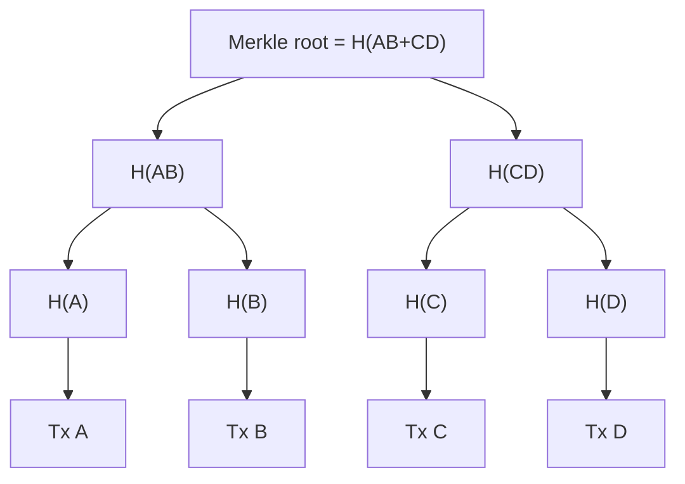

**In simple words:** a Merkle tree is a tree of hashes. It lets us check a huge list of transactions by comparing just one short hash at the top, the **Merkle root**. <Cite id="block-structure-merkle-wiki-merkle" />

**Definition:** a Merkle tree is a binary tree in which every leaf is the hash of a data item (a transaction) and every parent node is the hash of its two children joined together. The single hash at the top is the Merkle root, and it is stored in the block header. <Cite id="block-structure-merkle-gfg-merkle-intro" />

**How it is built (4 transactions A, B, C, D, with made-up labels):**

1. Hash each transaction: H(A), H(B), H(C), H(D).
2. Join pairs and hash: H(AB) = H(H(A) + H(B)) and H(CD) = H(H(C) + H(D)).
3. Join the two and hash: Root = H(H(AB) + H(CD)).
4. If a level has an odd number of nodes, Bitcoin copies the last one and pairs it with itself.

**Why it is useful:** (a) any change in data changes the root, so tampering is caught at once; (b) a light client can prove one transaction is in a block with only about log2(n) hashes (the Merkle proof) instead of downloading the whole block. <Cite id="block-structure-merkle-me-ch14" />

**Merkle Patricia Trie (MPT) in Ethereum**

Ethereum stores **key-value data** (account address to account state), not just a list of transactions. A plain Merkle tree is poor for this, since keys must be searched and updated often. So Ethereum uses the **Merkle Patricia Trie**, which mixes a Patricia (radix) trie with Merkle hashing. <Cite id="block-structure-merkle-eth-mpt" />

- The key is split into **hex digits (nibbles)**, and the path from the root follows these digits.
- **Node types:** *branch* (16 children, one per hex digit, plus a value), *extension* (shares a common path of several digits to save space), *leaf* (the rest of the path and the value).
- Each node is stored under the **Keccak-256 hash** of its content, so the root hash commits to the whole data.
- Every block header holds three roots: **stateRoot** (all accounts), **transactionsRoot** and **receiptsRoot**. Each contract also has its own storage trie. <Cite id="block-structure-merkle-eth-yellow" />

| | Merkle tree (Bitcoin) | Merkle Patricia Trie (Ethereum) |
|---|---|---|
| Stores | List of transactions | Key-value state |
| Shape | Binary tree | Trie with 16-way branches |
| Update one item | Rebuild a path | Only changed path is re-hashed |
| Proof of presence | Yes | Yes (and of absence) |

**Conclusion:** the Merkle root gives a short fingerprint of all the data, and Ethereum's MPT extends the idea to changing account state.
