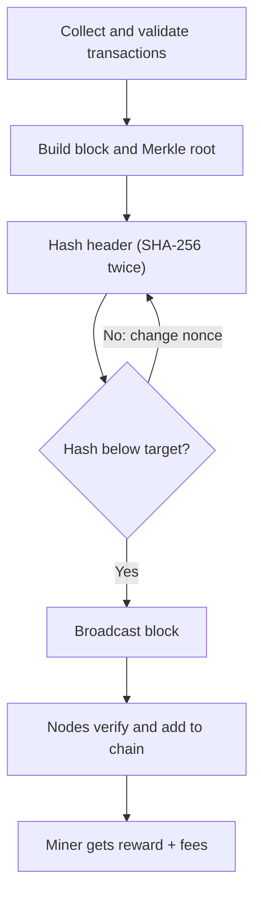

**In simple words:** mining wo kaam hai jo special computers (miners) karte hain: naye transactions check karna, unhe block mein pack karna aur block ko blockchain mein add karna. Jo miner pehle ek mushkil puzzle solve karta hai use block add karne ka haq milta hai aur reward milta hai. <Cite id="bitcoin-mb-ch12-mining" />

**Ye kyun zaroori hai:** payments approve karne ke liye koi central bank nahi hai. Mining (proof of work) hazaaron strangers ko ek history pe agree karne deti hai, aur naye coins bhi banati hai.

**Mining ke steps (Bitcoin):**

1. **Collect:** mempool (transactions ka waiting room) se unconfirmed transactions lo.
2. **Validate:** har ek ko check karo: valid signature, coins pehle spend na hue hon, sahi format.
3. **Candidate block banao:** *coinbase* transaction add karo (miner ke apne address pe reward plus fees) aur saare transactions ka Merkle root nikalo.
4. **Block header banao:** version, previous block hash, Merkle root, timestamp, difficulty target (bits) aur nonce.
5. **Header ko do baar SHA-256 se hash karo.** Agar result target se chhota nahi hai to nonce badlo (aur nonce range khatam hone pe extra nonce) aur phir try karo. Ye trial and error hai, har second arbon baar.
6. **Valid hash mil gaya:** block network pe broadcast karo.
7. **Baaki nodes verify karte hain:** ek hash se aur saare transactions check karke. Valid ho to add karte hain aur uske upar mining shuru karte hain.
8. **Reward:** winner ko block subsidy plus transaction fees milti hai. <Cite id="bitcoin-btcwiki-mining" />

**Key points:**

- **Difficulty** har 2016 blocks pe adjust hoti hai taaki lagbhag har 10 minute mein ek block aaye. Zyada miners ka matlab zyada difficulty. <Cite id="bitcoin-btcwiki-difficulty" />
- **Reward halving:** subsidy har 210,000 blocks (lagbhag 4 saal) mein aadhi hoti hai. Pehle 6.25 BTC thi aur April 2024 se 3.125 BTC hai. <Cite id="bitcoin-btcwiki-halving" />
- **Mining pools:** chhote miners milkar kaam aur reward share karte hain, taaki steady income mile.
- **Hardware:** CPU, phir GPU, phir ASIC machines.
- **Forks:** agar do miners ek saath jeetein to chain thodi der ke liye split hoti hai, aur lambi chain jeetati hai; dusra block orphan (stale) ban jaata hai.
- **Drawbacks:** bahut bijli ka use aur mining centralisation ka risk.

**Conclusion:** mining block creation ko costly banakar Bitcoin ko secure karti hai, aur honest miners ko iske liye reward deti hai. <Cite id="consensus-mining-gfg-pow" />
