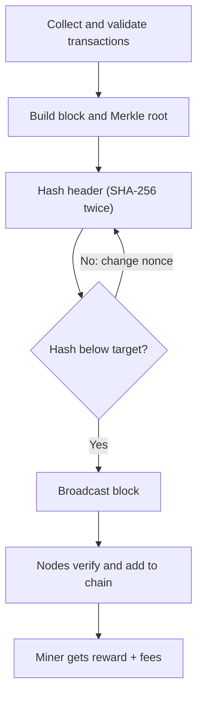

**In simple words:** mining is the work done by special computers (miners) to check new transactions, pack them into a block and add that block to the blockchain. The first miner to solve a hard puzzle wins the right to add the block and gets a reward. <Cite id="bitcoin-mb-ch12-mining" />

**Why it is needed:** there is no central bank to approve payments. Mining (proof of work) lets thousands of strangers agree on one history, and it also creates new coins.

**Steps of mining (Bitcoin):**

1. **Collect** unconfirmed transactions from the mempool (the waiting room of transactions).
2. **Validate** each: valid signature, coins not spent already, correct format.
3. **Build a candidate block:** add a *coinbase* transaction (reward plus fees to the miner's own address) and compute the Merkle root of all transactions.
4. **Make the block header:** version, previous block hash, Merkle root, timestamp, difficulty target (bits) and a nonce.
5. **Hash the header twice with SHA-256.** If the result is not below the target, change the nonce (and, when the nonce range ends, the extra nonce) and try again. This is trial and error, billions of times per second.
6. **Found a valid hash:** broadcast the block to the network.
7. **Other nodes verify** it with one hash and check all transactions. If valid, they add it and start mining on top of it.
8. **Reward:** the winner receives the block subsidy plus transaction fees. <Cite id="bitcoin-btcwiki-mining" />

**Key points:**

- **Difficulty** is adjusted every 2016 blocks so that a block comes about every 10 minutes. More miners means higher difficulty. <Cite id="bitcoin-btcwiki-difficulty" />
- **Reward halving:** the subsidy halves every 210,000 blocks (about 4 years). It was 6.25 BTC and has been 3.125 BTC since April 2024. <Cite id="bitcoin-btcwiki-halving" />
- **Mining pools:** small miners join to share work and rewards, to get steady income.
- **Hardware:** CPU, then GPU, then ASIC machines.
- **Forks:** if two miners win together, the chain splits briefly, and the longer chain wins; the other block becomes an orphan (stale).
- **Drawbacks:** huge electricity use and risk of mining centralisation.

**Conclusion:** mining secures Bitcoin by making block creation costly, and rewards honest miners for doing it. <Cite id="consensus-mining-gfg-pow" />
