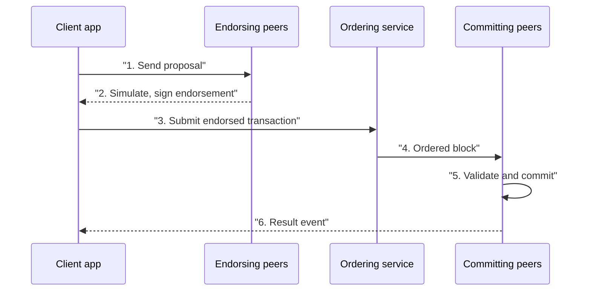

**In simple words:** Hyperledger Fabric businesses ke liye ek open-source **permissioned** blockchain platform hai, jo Linux Foundation host karta hai. Sirf known aur approved organisations join karte hain, aur network plug-in parts se bana hota hai. <Cite id="hyperledger-fabric-whatis" />

**Ye kyun zaroori hai:** businesses ko privacy, identity aur speed wala shared ledger chahiye, jo public chains nahi deti. Fabric ye deta hai.

**Main components:**

1. **Peers:** nodes jo ledger rakhte hain aur chaincode chalate hain. *Endorsing peers* transactions simulate karke sign karte hain, *committing peers* blocks likhte hain. <Cite id="hyperledger-fabric-ledger" />
2. **Ordering service:** transactions ko ek order mein rakhti hai aur blocks banati hai (current versions mein Raft). Ye contents nahi padhti.
3. **Membership Service Provider (MSP) aur Certificate Authority (CA):** har member ko digital certificate (identity) dete hain aur decide karte hain ki kaun kya kar sakta hai.
4. **Channels:** private sub-networks. Sirf channel ke members uska ledger dekhte hain, to do companies shared network pe private trade kar sakti hain.
5. **Ledger:** do parts, *world state* (current values, database mein) aur *blockchain* (saare changes ka log).
6. **Chaincode:** smart contract, Go, Java ya JavaScript mein likha, Docker container mein chalta hai.
7. **Policies:** endorsement policy (jaise "3 mein se 2 orgs sign karein") decide karti hai ki transaction kab valid hai.

**Transaction flow (execute, order, validate):**

<Cite id="hyperledger-fabric-txflow" />

**Features:** permissioned, modular consensus, private channels aur private data, cryptocurrency ki zaroorat nahi, high throughput, aur normal languages mein smart contracts.

**Applications:** supply chain, trade finance, healthcare records aur digital identity. <Cite id="hyperledger-fabric-gfg-fabric" />

**Fabric vs Bitcoin/Ethereum:**

| | Fabric | Public chains |
|---|---|---|
| Access | Permissioned | Open |
| Consensus | Pluggable (Raft) | PoW / PoS |
| Privacy | Channels, private data | Sab kuch public |
| Coin | Zaroori nahi | Native coin |
| Model | Execute-order-validate | Order-execute |

**Limitation:** set up karna zyada complex hai, aur public chains se kam decentralised hai.

**Conclusion:** Fabric ek enterprise-grade, modular, permissioned blockchain hai. <Cite id="hyperledger-fabric-ibm-fabric" />
