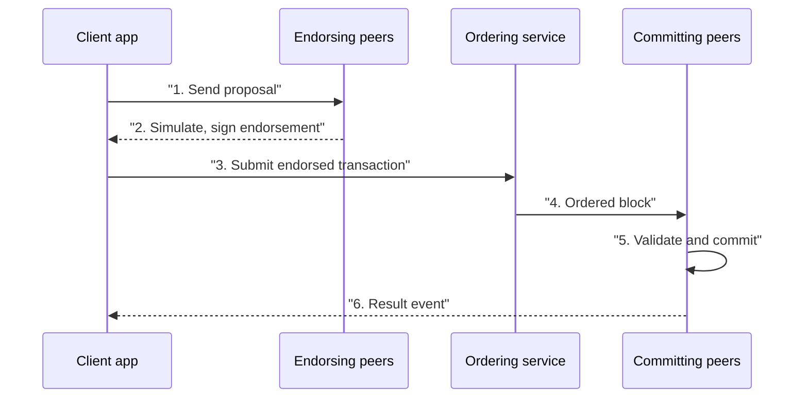

**In simple words:** Hyperledger Fabric is an open-source **permissioned** blockchain platform for businesses, hosted by the Linux Foundation. Only known and approved organisations join, and the network is built from plug-in parts. <Cite id="hyperledger-fabric-whatis" />

**Why it is needed:** businesses want a shared ledger with privacy, identity, and speed, which public chains do not give. Fabric offers that.

**Main components:**

1. **Peers:** nodes that hold the ledger and run chaincode. *Endorsing peers* simulate and sign transactions, *committing peers* write blocks. <Cite id="hyperledger-fabric-ledger" />
2. **Ordering service:** puts transactions in a single order and cuts blocks (Raft in current versions). It does not read the contents.
3. **Membership Service Provider (MSP) and Certificate Authority (CA):** give each member a digital certificate (identity) and decide who can do what.
4. **Channels:** private sub-networks. Only members of a channel see its ledger, so two companies can trade privately on a shared network.
5. **Ledger:** two parts, the *world state* (current values, in a database) and the *blockchain* (the log of all changes).
6. **Chaincode:** the smart contract, written in Go, Java or JavaScript, run in a Docker container.
7. **Policies:** endorsement policy (e.g. "2 of 3 orgs must sign") decides when a transaction is valid.

**Transaction flow (execute, order, validate):**

<Cite id="hyperledger-fabric-txflow" />

**Features:** permissioned, modular consensus, private channels and private data, no cryptocurrency needed, high throughput, and smart contracts in normal languages.

**Applications:** supply chain, trade finance, healthcare records, and digital identity. <Cite id="hyperledger-fabric-gfg-fabric" />

**Fabric vs Bitcoin/Ethereum:**

| | Fabric | Public chains |
|---|---|---|
| Access | Permissioned | Open |
| Consensus | Pluggable (Raft) | PoW / PoS |
| Privacy | Channels, private data | Everything public |
| Coin | Not required | Native coin |
| Model | Execute-order-validate | Order-execute |

**Limitation:** more complex to set up, and less decentralised than public chains.

**Conclusion:** Fabric is an enterprise-grade, modular, permissioned blockchain. <Cite id="hyperledger-fabric-ibm-fabric" />
