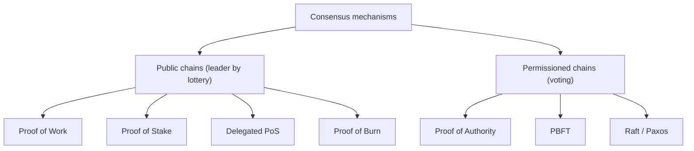

**In simple words:** consensus mechanism wo rule hai jisse blockchain ke saare nodes, kisi central boss ke bina, agree karte hain ki agla valid block kaun sa hai. Alag chains alag mechanisms use karti hain. <Cite id="consensus-mining-gfg-consensus" />

**Types**

1. **Proof of Work (PoW).** Miners aisa nonce dhoondhne mein compete karte hain jisse hash target se chhota aaye. Winner block add karta hai aur reward leta hai. Secure hai lekin slow aur energy-hungry. Bitcoin use karta hai. <Cite id="consensus-mining-wiki-pow" />
2. **Proof of Stake (PoS).** Validators coins lock (stake) karte hain. Stake ke hisaab se ek chuna jaata hai block propose karne ke liye, aur baaki attest karte hain. Cheating pe stake jaata hai (slashing). Kam energy. Ethereum 2022 ke Merge se use karta hai. <Cite id="consensus-mining-wiki-pos" />
3. **Delegated Proof of Stake (DPoS).** Coin holders chhote se delegates ke set ko vote karte hain jo baari-baari blocks banate hain. Fast, lekin zyada centralised. EOS use karta hai.
4. **Proof of Authority (PoA).** Kuch approved, known validators blocks sign karte hain, aur unki reputation hi stake hai. Fast; private aur test networks mein use hota hai. <Cite id="consensus-mining-wiki-poa" />
5. **Proof of Burn (PoB).** Miners coins ek aise address pe bhejte hain jo spend nahi ho sakta, yaani "burn" karte hain, mining ka haq paane ke liye. Ye bijli ki jagah coins waste karta hai.
6. **Proof of Capacity / Space.** Miners prove karte hain ki unhone disk space alag rakha hai.
7. **Practical Byzantine Fault Tolerance (PBFT).** n known nodes pre-prepare, prepare aur commit votes exchange karte hain, aur ye tab tak chalta hai jab tak zyada se zyada f nodes faulty hon aur n kam se kam 3f + 1 ho. Instant finality deta hai. <Cite id="bft-paxos-raft-pbft-paper" />
8. **Raft / Paxos.** Leader aur majority ki crash-fault tolerant voting; Fabric ki ordering service jaise private networks mein use hota hai.

| Type | Blocks kaun banata hai | Energy | Speed | Used by |
|---|---|---|---|---|
| PoW | Best hasher | Very high | Slow | Bitcoin |
| PoS | Staker, random chuna hua | Low | Medium | Ethereum |
| DPoS | Elected delegates | Low | Fast | EOS |
| PoA | Approved validators | Low | Fast | Private chains |
| PBFT | Known nodes voting se | Low | Fast | Permissioned |

<Cite id="consensus-mining-gfg-crypto-consensus" />

**Conclusion:** public chains work ya stake se security, speed aur decentralisation ka balance banati hain, jabki private chains known nodes ke beech voting use karti hain.
