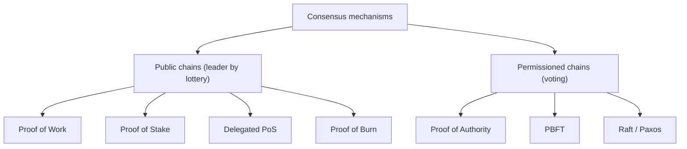

**In simple words:** a consensus mechanism is the rule by which all nodes of a blockchain agree on which block is the next valid one, without a central boss. Different chains use different mechanisms. <Cite id="consensus-mining-gfg-consensus" />

**Types**

1. **Proof of Work (PoW).** Miners compete to find a nonce giving a hash below the target. The winner adds the block and gets the reward. Secure but slow and energy-hungry. Used by Bitcoin. <Cite id="consensus-mining-wiki-pow" />
2. **Proof of Stake (PoS).** Validators lock up (stake) coins. One is picked in proportion to its stake to propose the block, and others attest. Cheating loses the stake (slashing). Low energy. Used by Ethereum since the 2022 Merge. <Cite id="consensus-mining-wiki-pos" />
3. **Delegated Proof of Stake (DPoS).** Coin holders vote for a small set of delegates who create blocks in turn. Fast, but more centralised. Used by EOS.
4. **Proof of Authority (PoA).** A few approved, known validators sign blocks, and their reputation is the stake. Fast; used in private and test networks. <Cite id="consensus-mining-wiki-poa" />
5. **Proof of Burn (PoB).** Miners send coins to an address that cannot be spent, "burning" them, to earn the right to mine. It wastes coins instead of electricity.
6. **Proof of Capacity / Space.** Miners prove they have set aside disk space.
7. **Practical Byzantine Fault Tolerance (PBFT).** A known set of n nodes exchange pre-prepare, prepare and commit votes, and it works while at most f nodes are faulty with n at least 3f + 1. Gives instant finality. <Cite id="bft-paxos-raft-pbft-paper" />
8. **Raft / Paxos.** Crash-fault tolerant voting by a leader and a majority; used in private networks such as Fabric's ordering service.

| Type | Who creates blocks | Energy | Speed | Used by |
|---|---|---|---|---|
| PoW | Best hasher | Very high | Slow | Bitcoin |
| PoS | Staker, chosen at random | Low | Medium | Ethereum |
| DPoS | Elected delegates | Low | Fast | EOS |
| PoA | Approved validators | Low | Fast | Private chains |
| PBFT | Known nodes by voting | Low | Fast | Permissioned |

<Cite id="consensus-mining-gfg-crypto-consensus" />

**Conclusion:** public chains balance security, speed and decentralisation by using work or stake, while private chains use voting among known nodes.
