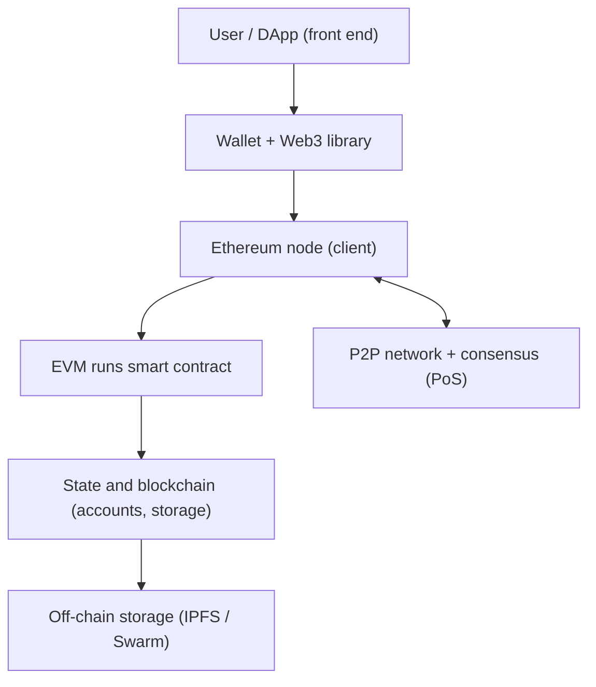

**In simple words:** Ethereum ek public blockchain hai jo programs (smart contracts) chala sakti hai, sirf coins nahi bhejti. Ye kai parts se bana hai jo saath kaam karte hain. <Cite id="ethereum-gfg-components" />

**Components**

1. **Ethereum accounts.** Externally owned accounts (keys se controlled) aur contract accounts (code se controlled). <Cite id="ethereum-eth-accounts" />
2. **Transactions aur messages.** Account ki signed instruction: ETH bhejna, contract deploy ya call karna. Isme nonce, gas limit aur gas price hota hai.
3. **Ether (ETH) aur gas.** ETH native coin hai aur computation ke liye pay karta hai. *Gas* kaam napta hai, aur fee = gas used x gas price. Isse infinite loops aur spam rukte hain. <Cite id="ethereum-eth-gas" />
4. **Ethereum Virtual Machine (EVM).** Wo sandbox jo contract bytecode ko har node pe same tarah chalata hai. <Cite id="ethereum-eth-evm" />
5. **Smart contracts.** Chain pe stored programs, aam taur pe Solidity mein likhe aur bytecode mein compile kiye.
6. **Blockchain aur state.** Blocks mein transactions hote hain; world state (saare balances aur storage) Merkle Patricia tries mein rakhi jaati hai.
7. **Nodes aur clients.** Geth jaise software chalane wale computers jo chain store aur verify karte hain. <Cite id="ethereum-eth-nodes" />
8. **Consensus.** 2022 se Proof of Stake (pehle Proof of Work).
9. **Wallets aur Web3.** Wallets (MetaMask) keys rakhte aur sign karte hain; web3.js ya ethers.js jaisi libraries apps ko node se jodti hain.
10. **DApps.** Front end plus smart contracts. Bade files off-chain IPFS ya Swarm mein rakhi jaati hain. <Cite id="ethereum-eth-stack" />
11. **Networks.** Mainnet asli ETH ke liye, aur Sepolia jaise testnets practice ke liye.

**Example:** user NFT DApp mein "Buy" dabata hai. Wallet transaction sign karta hai, node use network ko deta hai, validators ise include karte hain, EVM contract chalata hai, aur state mein owner field badal jaati hai. <Cite id="ethereum-whitepaper" />

**Conclusion:** EVM, accounts, gas, nodes aur contracts milkar Ethereum ko ek world computer banate hain.
