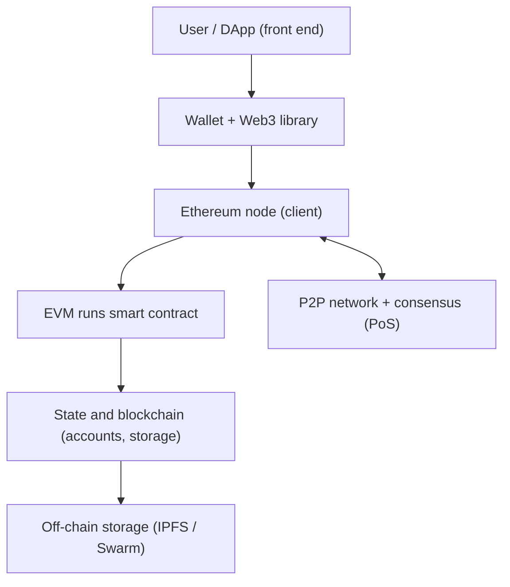

**In simple words:** Ethereum is a public blockchain that can run programs (smart contracts), not just move coins. It is made of several parts that work together. <Cite id="ethereum-gfg-components" />

**Components**

1. **Ethereum accounts.** Externally owned accounts (controlled by keys) and contract accounts (controlled by code). <Cite id="ethereum-eth-accounts" />
2. **Transactions and messages.** A signed instruction from an account: send ETH, deploy or call a contract. It carries a nonce, gas limit and gas price.
3. **Ether (ETH) and gas.** ETH is the native coin and pays for computation. *Gas* measures the work, and fee = gas used x gas price. This stops infinite loops and spam. <Cite id="ethereum-eth-gas" />
4. **Ethereum Virtual Machine (EVM).** The sandbox that runs contract bytecode in the same way on every node. <Cite id="ethereum-eth-evm" />
5. **Smart contracts.** Programs stored on the chain, usually written in Solidity and compiled to bytecode.
6. **Blockchain and state.** Blocks hold transactions; the world state (all balances and storage) is kept in Merkle Patricia tries.
7. **Nodes and clients.** Computers running software such as Geth that store and verify the chain. <Cite id="ethereum-eth-nodes" />
8. **Consensus.** Proof of Stake since 2022 (before that, Proof of Work).
9. **Wallets and Web3.** Wallets (MetaMask) keep keys and sign; libraries such as web3.js or ethers.js connect apps to a node.
10. **DApps.** Front end plus smart contracts. Large files are kept off-chain in IPFS or Swarm. <Cite id="ethereum-eth-stack" />
11. **Networks.** Mainnet for real ETH, and testnets such as Sepolia for practice.

**Example:** a user clicks "Buy" in an NFT DApp. The wallet signs a transaction, a node passes it to the network, validators include it, the EVM runs the contract, and the owner field in the state changes. <Cite id="ethereum-whitepaper" />

**Conclusion:** the EVM, accounts, gas, nodes and contracts together make Ethereum a world computer.
