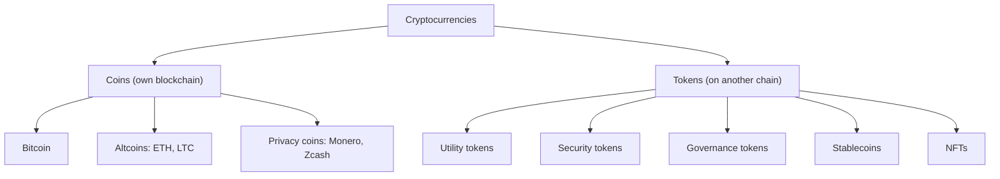

**In simple words:** cryptocurrency digital money hai jo cryptography se secure hai aur blockchain pe rakhi jaati hai. Kai kisme hain, jo is hisaab se group hote hain ki unka kaam kya hai. <Cite id="cryptocurrencies-tokens-wiki-crypto" />

**Types**

1. **Bitcoin (BTC).** Pehli aur sabse badi, store of value aur payment method, 21 million ki fixed supply ke saath.
2. **Altcoins.** Bitcoin ke alawa koi bhi coin jo apni chain chalata hai. Ether (ETH) smart contracts chalata hai, Litecoin faster digital cash hai, aur Ripple ka XRP payments ke liye hai.
3. **Utility tokens.** Platform pe product ya service ka access dete hain (jaise Binance pe fees ke liye BNB, oracle data ke payment ke liye LINK). <Cite id="cryptocurrencies-tokens-gfg-coins-tokens" />
4. **Security tokens.** Digital shares ya bonds jo kisi real asset ki ownership represent karte hain aur securities law ke under aate hain.
5. **Governance tokens.** Protocol pe voting rights dete hain (jaise UNI).
6. **Stablecoins.** Currency ya asset se jude hone ki wajah se price steady rakhte hain. Fiat-backed (USDT, USDC), crypto-backed (DAI) aur algorithmic hote hain. Algorithmic stablecoins fail hue hain (TerraUSD, 2022). <Cite id="cryptocurrencies-tokens-wiki-stablecoin" />
7. **Privacy coins.** Sender, receiver aur amount chhupate hain (Monero, Zcash).
8. **Non-fungible tokens (NFTs).** Unique digital items (ERC721).
9. **Meme coins.** Mazaak se shuru hue (Dogecoin); value community hype se aati hai, to bahut risky hain.
10. **CBDC.** Central bank dwara issue digital currency (India ka digital rupee). Ye decentralised nahi hai, to kai log ise cryptocurrency nahi kehte.

| Type | Backed by | Price | Example |
|---|---|---|---|
| Coin | Own network | Volatile | BTC, ETH |
| Utility token | Platform use | Volatile | BNB |
| Security token | Real asset | Asset ko follow | Tokenised bond |
| Stablecoin | Fiat / crypto | Stable | USDC |

<Cite id="cryptocurrencies-tokens-gfg-security-token" /> <Cite id="cryptocurrencies-tokens-me-ch10" />

**Conclusion:** coins apne networks chalate hain, aur tokens kisi aur ke network pe sawaar hote hain. Har type alag use ke liye fit hai.
