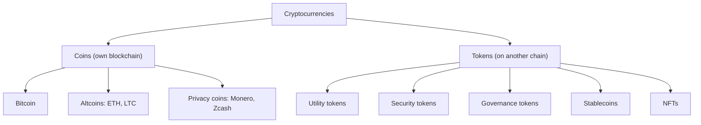

**In simple words:** a cryptocurrency is digital money secured by cryptography and kept on a blockchain. There are many kinds, grouped by what they are meant to do. <Cite id="cryptocurrencies-tokens-wiki-crypto" />

**Types**

1. **Bitcoin (BTC).** The first and largest, a store of value and payment method with a fixed supply of 21 million.
2. **Altcoins.** Any coin other than Bitcoin that runs its own chain. Ether (ETH) powers smart contracts, Litecoin is faster digital cash, and Ripple's XRP is for payments.
3. **Utility tokens.** Give access to a product or service on a platform (for example, BNB for fees on Binance, LINK to pay for oracle data). <Cite id="cryptocurrencies-tokens-gfg-coins-tokens" />
4. **Security tokens.** Digital shares or bonds that represent ownership in a real asset and fall under securities law.
5. **Governance tokens.** Give voting rights over a protocol (for example UNI).
6. **Stablecoins.** Keep a steady price by being tied to a currency or asset. Fiat-backed (USDT, USDC), crypto-backed (DAI) and algorithmic ones exist. Some algorithmic stablecoins have failed (TerraUSD, 2022). <Cite id="cryptocurrencies-tokens-wiki-stablecoin" />
7. **Privacy coins.** Hide sender, receiver and amount (Monero, Zcash).
8. **Non-fungible tokens (NFTs).** Unique digital items (ERC721).
9. **Meme coins.** Started as jokes (Dogecoin); value comes from community hype, so they are very risky.
10. **CBDC.** Digital currency issued by a central bank (India's digital rupee). It is not decentralised, so many people do not call it a cryptocurrency.

| Type | Backed by | Price | Example |
|---|---|---|---|
| Coin | Own network | Volatile | BTC, ETH |
| Utility token | Platform use | Volatile | BNB |
| Security token | Real asset | Follows asset | Tokenised bond |
| Stablecoin | Fiat / crypto | Stable | USDC |

<Cite id="cryptocurrencies-tokens-gfg-security-token" /> <Cite id="cryptocurrencies-tokens-me-ch10" />

**Conclusion:** coins run their own networks, and tokens ride on someone else's. Each type fits a different use.
