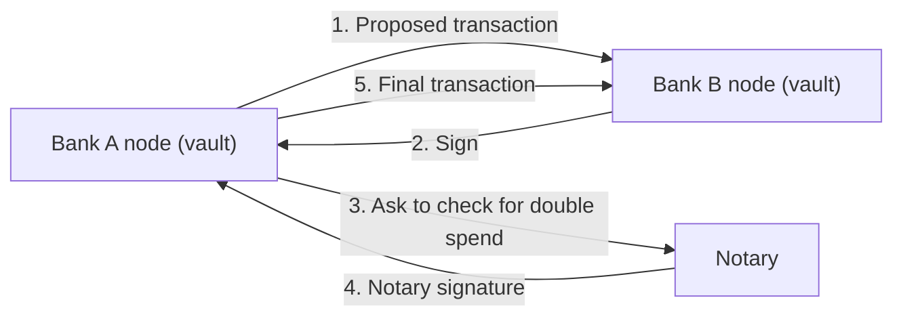

**In simple words:** ye **R3 Corda** ki case study hai, jo banks aur dusre regulated businesses ke liye bana ek open-source blockchain platform hai. Bitcoin se alag, Corda har deal sirf involved parties ke saath share karta hai. <Cite id="corda-ripple-quorum-corda-intro-wp" />

**Background aur problem:** har bank apni books rakhta hai, to ek hi deal kai jagah record hoti hai aur haath se match karni padti hai (reconciliation). Ye slow, costly aur error-prone hai. Banks sensitive deals public chain pe bhi nahi daal sakte jahan sab dekh sakein.

**Solution (Corda ka design):**

1. **States.** Ledger pe ek fact, jaise 1 crore ka loan, ek immutable *state object* hai. Deal purani state consume karke nayi state banane se badalti hai (Bitcoin ke UTXO jaisa).
2. **Contracts.** Code (Java/Kotlin) jo batata hai ki transaction kab valid hai. Ye words mein legal agreement se juda hota hai.
3. **Flows.** Code jo parties ko seedha baat karke transaction pe step by step agree karne deta hai.
4. **Point-to-point sharing.** Global broadcast nahi hota. Sirf parties (aur jise deal dekhna ho) state apne *vault* mein rakhte hain. Isse privacy milti hai.
5. **Notary.** Ek trusted service (ya cluster) jo confirm karti hai ki state pehle spend nahi hui, to double spending ruk jaati hai. Ye time-stamp bhi de sakti hai.
6. **Identity aur permission.** Har node ko network operator se certificate milta hai. <Cite id="corda-ripple-quorum-xoriant-corda" />

**Use case:** trade finance, insurance claims aur syndicated loans, jahan kuch known parties ek agreement share karti hain aur unhe privacy aur legal clarity chahiye. <Cite id="corda-ripple-quorum-corda-github" />

**Strengths aur limits:**

| Strengths | Limits |
|---|---|
| Privacy by design | Ethereum se chhoti community |
| Contracts se legal link | Trusted network aur notary chahiye |
| No mining, fast finality | Public, open coins ke liye nahi |

**Lesson:** blockchain ko Bitcoin ki copy hona zaroori nahi. Corda dikhata hai ki idea ko business ke liye kaise badla ja sakta hai, global broadcast ki jagah privacy aur legal fit lekar. <Cite id="corda-ripple-quorum-corda-tech-wp" />
