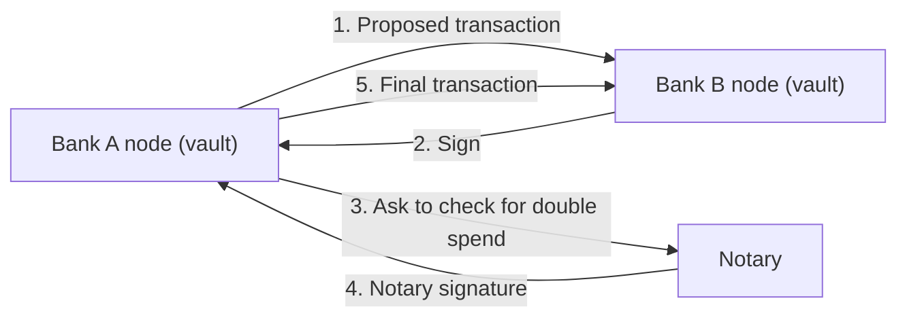

**In simple words:** this is a case study of **R3 Corda**, an open-source blockchain platform built for banks and other regulated businesses. Unlike Bitcoin, Corda shares each deal only with the parties involved. <Cite id="corda-ripple-quorum-corda-intro-wp" />

**Background and problem:** every bank keeps its own books, so the same deal is recorded in many places and must be matched by hand (reconciliation). This is slow, costly and error-prone. Banks also cannot put sensitive deals on a public chain where all can see them.

**Solution (Corda's design):**

1. **States.** A fact on the ledger, such as a loan of 1 crore, is an immutable *state object*. A deal changes by consuming the old state and creating a new one (similar to Bitcoin's UTXO).
2. **Contracts.** Code (Java/Kotlin) that says when a transaction is valid. It is tied to the legal agreement in words.
3. **Flows.** Code that lets parties talk directly and agree on a transaction step by step.
4. **Point-to-point sharing.** There is no global broadcast. Only the parties (and anyone who needs to see the deal) hold the state, in a *vault*. This gives privacy.
5. **Notary.** A trusted service (or cluster) that confirms a state has not been spent already, so double spending is stopped. It can also give a time-stamp.
6. **Identity and permission.** Every node has a certificate from a network operator. <Cite id="corda-ripple-quorum-xoriant-corda" />

**Use case:** trade finance, insurance claims and syndicated loans, where a few known parties share an agreement and need privacy and legal clarity. <Cite id="corda-ripple-quorum-corda-github" />

**Strengths and limits:**

| Strengths | Limits |
|---|---|
| Privacy by design | Smaller community than Ethereum |
| Legal link to contracts | Needs trusted network and notary |
| No mining, fast finality | Not for public, open coins |

**Lesson:** a blockchain need not copy Bitcoin. Corda shows how the idea can be reshaped for business, trading global broadcast for privacy and legal fit. <Cite id="corda-ripple-quorum-corda-tech-wp" />
