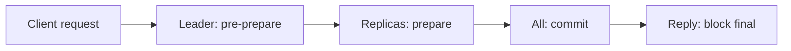

**In simple words:** in a private blockchain all validators are known and approved, so there is no need for costly mining. The nodes can simply **vote** until they agree. This is faster and uses almost no energy. <Cite id="private-blockchain-gfg-private" />

**Why voting works here:** the number of nodes is small and their identities are known, so the network can count votes and a bad node can be identified and removed.

**Common methods**

1. **Raft (crash fault tolerant).** One *leader* is elected. Clients send commands to the leader, who copies them to *followers*. When a majority confirms, the entry is committed. If the leader fails, a new election starts. It assumes nodes may crash but do not lie, so it needs n at least 2f + 1 to survive f failures. Used in Hyperledger Fabric's ordering service. <Cite id="bft-paxos-raft-raft-paper" /> <Cite id="bft-paxos-raft-fabric-orderer" />
2. **Paxos.** An older crash-tolerant protocol with the same majority idea (proposers, acceptors, learners). Hard to understand, so Raft was made as an easier alternative.
3. **PBFT (Byzantine fault tolerant).** Handles nodes that are faulty or even malicious. Nodes pass three phases (pre-prepare, prepare, commit) and need n at least 3f + 1. Gives instant finality. Network messages grow as n squared, so it suits small groups. <Cite id="bft-paxos-raft-gfg-pbft" />
4. **IBFT / QBFT.** PBFT-style voting for Ethereum-based private chains such as Quorum. <Cite id="corda-ripple-quorum-quorum-ibft" />
5. **Proof of Authority.** Approved validators sign blocks in turn.

| | Raft | PBFT |
|---|---|---|
| Faults handled | Crash only | Crash and malicious |
| Nodes needed for f faults | 2f + 1 | 3f + 1 |
| Example | 3 nodes survive 1 crash | 4 nodes survive 1 bad node |
| Speed | Very fast | Fast, slows with many nodes |

**Conclusion:** private chains replace mining by voting among known nodes. Pick Raft if you trust members not to lie, and PBFT if some may be malicious.
