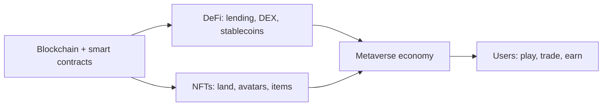

**In simple words:** DeFi bank ke bina banking hai, jo smart contracts chalate hain. Metaverse ek shared virtual world hai. Blockchain DeFi ko money rails deti hai aur Metaverse ko items ki ownership. <Cite id="blockchain-applications-ethereum-org-defi" />

**1. Decentralised Finance (DeFi)**

- **Meaning:** financial services (lending, borrowing, trading, savings, insurance) jo public blockchain, zyadatar Ethereum, pe smart contracts dete hain, beech mein bank ke bina. <Cite id="smart-contracts-wiki-defi" />
- **Building blocks:** stablecoins, decentralised exchanges (DEX, jaise Uniswap), lending pools (Aave, Compound), yield farming aur wallets.
- **Kaise kaam karta hai:** user wallet connect karta hai, tokens contract mein deposit karta hai, aur contract unhe doosron ko code dwara set interest rate pe lend karta hai. Koi bhi, kahin se bhi, sirf wallet se use kar sakta hai.
- **Benefits:** sabke liye open, 24x7 chalta hai, transparent code, aur users apni keys khud rakhte hain.
- **Risks:** smart-contract bugs aur hacks, price swings, scams, aur unclear regulation.

**2. Metaverse**

- **Meaning:** ek persistent, shared 3D virtual world jahan log (avatars ki tarah) milte, khelte, kaam karte aur trade karte hain. <Cite id="cryptocurrencies-tokens-wiki-metaverse" />
- **Blockchain ka role:** ye digital land, avatars aur items ki ownership **NFTs** ke roop mein prove karti hai, world ke andar payment ke liye **cryptocurrency** deti hai, aur **DAOs** community ko rules pe vote karne dete hain. Items phir platforms ke beech move ho sakte hain. <Cite id="blockchain-applications-ethereum-org-nft" />
- **Examples:** Decentraland aur The Sandbox (tokens se khareedi gayi virtual land).
- **Challenges:** high cost, slow speed, privacy aur safety issues, aur abhi tak kam users.

**Dono ka link:** virtual world mein user token se land khareed sakta hai, us land ko DeFi loan mein collateral rakh sakta hai, aur stablecoins mein rent kama sakta hai. <Cite id="cryptocurrencies-tokens-gfg-metaverse" />

**Conclusion:** DeFi finance ko sabke liye khol deta hai, aur Metaverse blockchain se digital cheezon ko ownable banata hai. Dono exciting hain par risky aur abhi naye hain.
