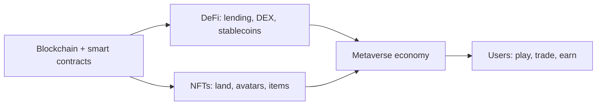

**In simple words:** DeFi is banking without a bank, run by smart contracts. The Metaverse is a shared virtual world. Blockchain gives DeFi its money rails and the Metaverse its ownership of items. <Cite id="blockchain-applications-ethereum-org-defi" />

**1. Decentralised Finance (DeFi)**

- **Meaning:** financial services (lending, borrowing, trading, savings, insurance) delivered by smart contracts on a public blockchain, mostly Ethereum, with no bank in the middle. <Cite id="smart-contracts-wiki-defi" />
- **Building blocks:** stablecoins, decentralised exchanges (DEX, such as Uniswap), lending pools (Aave, Compound), yield farming and wallets.
- **How it works:** a user connects a wallet, deposits tokens into a contract, and the contract lends them to others at an interest rate set by code. Anyone, anywhere, can use it with just a wallet.
- **Benefits:** open to all, works 24x7, transparent code, and users keep their own keys.
- **Risks:** smart-contract bugs and hacks, price swings, scams, and unclear regulation.

**2. Metaverse**

- **Meaning:** a persistent, shared 3D virtual world where people (as avatars) meet, play, work and trade. <Cite id="cryptocurrencies-tokens-wiki-metaverse" />
- **Role of blockchain:** it proves who owns digital land, avatars and items as **NFTs**, it provides **cryptocurrency** to pay inside the world, and **DAOs** let the community vote on rules. Items can then move between platforms. <Cite id="blockchain-applications-ethereum-org-nft" />
- **Examples:** Decentraland and The Sandbox (virtual land bought with tokens).
- **Challenges:** high cost, slow speed, privacy and safety issues, and few users so far.

**Link between them:** in a virtual world a user can buy land with a token, put the land as collateral in a DeFi loan, and earn rent in stablecoins. <Cite id="cryptocurrencies-tokens-gfg-metaverse" />

**Conclusion:** DeFi opens finance to anyone, and the Metaverse uses blockchain to make digital things ownable. Both are exciting but risky and still young.
