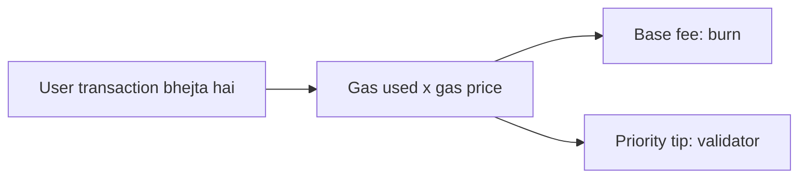

**In simple words:** **Ether (ETH)** Ethereum ka coin hai. **Gas** ek unit hai jo napta hai ki transaction ko kitna computing work chahiye. Gas ka payment ether mein hota hai, jaise petrol ka paisa rupees mein dete hain. <Cite id="ethereum-eth-ether" /> <Cite id="ethereum-eth-gas" />

**Ether (ETH):**

- Ethereum ki native cryptocurrency, fees dene ke liye aur value store karne ke liye use hoti hai.
- Sabse chhota unit **wei**: 1 ETH = $10^{18}$ wei. Beech ka unit **gwei**: 1 gwei = $10^{-9}$ ETH.
- Jo validators ETH stake karke network secure karte hain, unhe reward ETH mein milta hai.

**Gas:**

- EVM jo bhi step chalata hai (addition, storage write, transfer) uska fixed gas cost hota hai. Simple ETH transfer ka cost 21,000 gas hai. <Cite id="ethereum-gfg-evm" />
- **Kyun zaroori hai:** (1) validators ko unke kaam ka paisa milta hai, (2) spam rukta hai, (3) infinite loop rukta hai, kyunki gas khatam hote hi program ruk jaata hai.
- Terms: **gas limit** = tum maximum kitna gas allow karte ho; **gas used** = actually kitna use hua; **gas price** = har gas unit ke liye kitna ether, gwei mein. London upgrade (EIP-1559) ke baad price = **base fee** (burn hota hai) plus **priority tip** (validator ko).

$$
\text{Fee} = \text{gas used} \times \text{gas price}
$$

<Sum>

<Given>

Simple ETH transfer 21,000 gas use karta hai. Base fee = 18 gwei, tip = 2 gwei.

</Given>

<Find>

total fee gwei mein aur ETH mein.

</Find>

<Steps>

1. Gas price $= 18 + 2 = 20$ gwei. *Reason: price = base fee plus tip.*
2. Fee $= 21{,}000 \times 20 = 420{,}000$ gwei. *Reason: fee = gas used times gas price.*
3. ETH mein: $420{,}000 \times 10^{-9} = 0.00042$ ETH. *Reason: 1 gwei = $10^{-9}$ ETH.*

</Steps>

<Answer>

fee = 420,000 gwei = 0.00042 ETH

</Answer>

<Box kind="verify">

Todke dekho: burn hissa $21{,}000 \times 18 = 378{,}000$ gwei, tip hissa $21{,}000 \times 2 = 42{,}000$ gwei. $378{,}000 + 42{,}000 = 420{,}000$, total wahi aaya.

</Box>

</Sum>

**Bacha hua gas wapas milta hai.** Agar gas limit kam ho to transaction "out of gas" se fail hota hai aur kharch hua gas wapas nahi milta.

**Conclusion:** ether Ethereum ka paisa hai aur gas wo meter hai jo har computation ko apna kharch khud dene par majboor karta hai. <Cite id="ethereum-whitepaper" />

Exam mein English mein likho: "Gas measures the computational work of a transaction, and it is paid for in ether."
