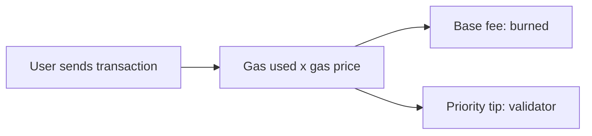

**In simple words:** **Ether (ETH)** is the coin of Ethereum. **Gas** is the unit that measures how much computing work a transaction needs. You pay for gas in ether, like paying for fuel in rupees. <Cite id="ethereum-eth-ether" /> <Cite id="ethereum-eth-gas" />

**Ether (ETH):**

- The native cryptocurrency of Ethereum, used to pay fees and also as a store of value.
- Smallest unit is **wei**: 1 ETH = $10^{18}$ wei. A common middle unit is **gwei**: 1 gwei = $10^{-9}$ ETH.
- Validators who stake ETH are rewarded in ETH for securing the network.

**Gas:**

- Every step the EVM runs (an addition, a storage write, a transfer) has a fixed gas cost. A plain ETH transfer costs 21,000 gas. <Cite id="ethereum-gfg-evm" />
- **Why it is needed:** (1) it pays the validators for their work, (2) it stops spam, and (3) it stops infinite loops, because a program that runs out of gas is halted.
- Terms: **gas limit** = the most gas you allow your transaction to use; **gas used** = what it actually used; **gas price** = ether you pay per unit of gas, in gwei. Since the London upgrade (EIP-1559) the price is a **base fee** (burned) plus a **priority tip** (to the validator).

$$
\text{Fee} = \text{gas used} \times \text{gas price}
$$

<Sum>

<Given>

A simple ETH transfer uses 21,000 gas. Base fee = 18 gwei, tip = 2 gwei.

</Given>

<Find>

the total fee in gwei and in ETH.

</Find>

<Steps>

1. Gas price $= 18 + 2 = 20$ gwei. *Reason: price is base fee plus tip.*
2. Fee $= 21{,}000 \times 20 = 420{,}000$ gwei. *Reason: fee is gas used times gas price.*
3. In ETH: $420{,}000 \times 10^{-9} = 0.00042$ ETH. *Reason: 1 gwei is $10^{-9}$ ETH.*

</Steps>

<Answer>

fee = 420,000 gwei = 0.00042 ETH

</Answer>

<Box kind="verify">

Split it: burned part $21{,}000 \times 18 = 378{,}000$ gwei, tip part $21{,}000 \times 2 = 42{,}000$ gwei. $378{,}000 + 42{,}000 = 420{,}000$, the same total.

</Box>

</Sum>

**Unused gas is refunded.** If the gas limit is too low the transaction fails ("out of gas") and the gas spent is not returned.

**Conclusion:** ether is the money of Ethereum and gas is the meter that makes every computation pay for itself. <Cite id="ethereum-whitepaper" />
