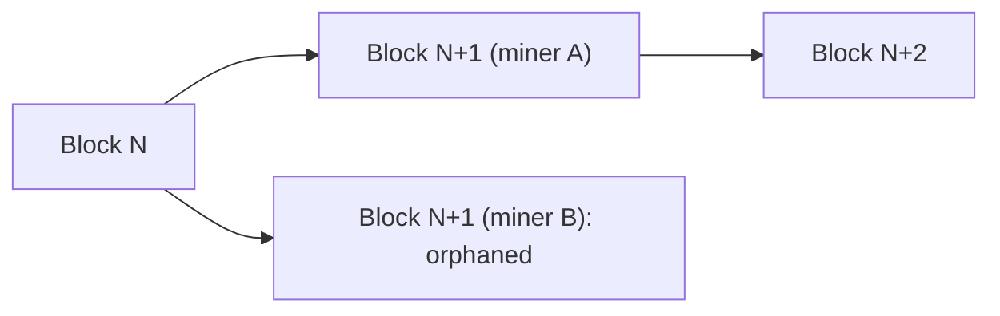

**In simple words:** **orphaned block** ek valid block hota hai jo mine hua lekin **main chain ka hissa nahi bana**, kyunki same height pe doosra block race jeet gaya. Uske miner ko reward nahi milta. <Cite id="block-structure-merkle-btcwiki-orphan" />

**Ye kaise hota hai:**

1. Network mein koi central clock nahi hai, aur blocks ko nodes ke beech pahunchne mein time lagta hai.
2. Do miners, A aur B, lagbhag ek hi time pe puzzle solve karte hain, dono block N ke upar.
3. Kuch nodes ko pehle A ka block N+1 milta hai, kuch ko B ka. Chain temporarily **fork** ho jaati hai.
4. Miners wahi block extend karte hain jo unhone pehle dekha.
5. Agla block N+2 kisi ek branch pe milta hai, maan lo A ki. Nodes **longest (most-work) chain** rule follow karke A ki branch pe switch ho jaate hain.
6. B ka block drop ho jaata hai aur orphaned ban jaata hai. Uske transactions memory pool mein wapas jaate hain aur baad mein include hote hain, agar A ki branch mein pehle se nahi hain. <Cite id="consensus-mining-gfg-conflicts" />

**Effects:**

- Orphan ke miner ka block reward aur bijli ka kharch dono waste.
- Uske transactions late hote hain, isliye exchanges payment final maanne se pehle kai **confirmations** (aam taur pe 6) ka wait karte hain.
- Zyada orphans se network ki efficiency girti hai aur security thodi kamzor hoti hai.

**Naming note:** strictly, Bitcoin docs side branch ke valid block ko **stale block** kehte hain, aur "orphan" wo block hai jiska parent abhi pata nahi. Rozmarra mein dono ko orphaned bolte hain. Ethereum (Merge se pehle) inhe **uncle/ommer blocks** kehta tha aur chhota reward deta tha. <Cite id="consensus-mining-btcwiki-orphan" /> <Cite id="block-structure-merkle-me-ch14" />

**Conclusion:** orphan blocks decentralised mining mein network delay ka normal side effect hain, aur longest-chain rule unhe automatically resolve kar deta hai.

Exam mein English mein likho: "An orphaned block is a valid block that is not part of the main chain."
