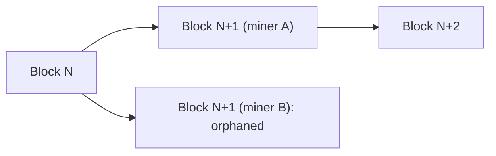

**In simple words:** an **orphaned block** is a valid block that was mined but is **not part of the main chain**, because another block at the same height won the race. Its miner gets no reward. <Cite id="block-structure-merkle-btcwiki-orphan" />

**How it happens:**

1. The network has no central clock, and blocks take time to travel between nodes.
2. Two miners, say A and B, solve the puzzle at almost the same time, both on top of block N.
3. Some nodes first receive A's block N+1, others receive B's. The chain has temporarily **forked**.
4. Miners keep working on whichever block they saw first.
5. The next block, N+2, is found on top of one branch, say A's. Nodes follow the **longest (most-work) chain** rule and switch to A's branch.
6. B's block is dropped and becomes orphaned. Its transactions go back to the memory pool and are included later, unless already in A's branch. <Cite id="consensus-mining-gfg-conflicts" />

**Effects:**

- The orphan's miner loses the block reward and the electricity spent.
- Transactions in it are delayed, which is why exchanges wait for several **confirmations** (commonly 6) before treating a payment as final.
- More orphans make the network less efficient and slightly weaken security.

**Naming note:** strictly, Bitcoin docs call a valid block on a side branch a **stale block**, and an "orphan" is a block whose parent is not yet known. In everyday use, both are called orphaned. Ethereum (before the Merge) called them **uncle/ommer blocks** and paid a small reward for them. <Cite id="consensus-mining-btcwiki-orphan" /> <Cite id="block-structure-merkle-me-ch14" />

**Conclusion:** orphan blocks are a normal side effect of decentralised mining with network delay, and the longest-chain rule resolves them automatically.
