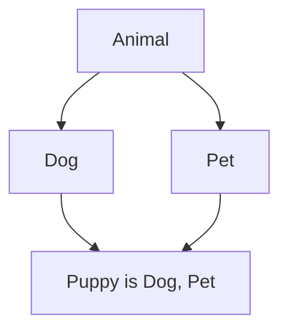

**In simple words:** Solidity mein ek contract **kai parent contracts** se ek saath inherit kar sakta hai, aise likhte hain `contract C is A, B`. Child ko saare parents ke state variables aur functions mil jaate hain. Solidity parents ka code child mein copy karta hai aur **C3 linearization** rule se decide karta hai ki do parents mein same function ho to kaun jeete. <Cite id="solidity-docs-inheritance" />

**Yaad rakhne ke rules:**

1. Parents ko "most base-like" se "most derived" ke order mein likho. `is Dog, Pet` mein `Pet` sabse derived hai. Galat order pe compile error aata hai.
2. Jo function child badal sakta hai use parent mein `virtual` mark karte hain, aur child `override` likhta hai.
3. Agar do parents mein same function hai to child ko `override(Dog, Pet)` likhna padta hai.
4. `super.f()` linearized order mein agle contract ko call karta hai, zaroori nahi ki direct parent ho. <Cite id="solidity-gfg-inheritance" />

**Example:**

```solidity
// SPDX-License-Identifier: MIT
pragma solidity ^0.8.0;

contract Animal {
    function sound() public pure virtual returns (string memory) {
        return "some sound";
    }
}

contract Dog is Animal {
    function sound() public pure virtual override returns (string memory) {
        return "bark";
    }
}

contract Pet is Animal {
    function sound() public pure virtual override returns (string memory) {
        return "purr";
    }
}

// Order matters: the right-most parent (Pet) is the most derived.
contract Puppy is Dog, Pet {
    function sound() public pure override(Dog, Pet) returns (string memory) {
        return super.sound();
    }
}
```

**Line by line:** `Animal` base hai jisme default `sound()` hai. `Dog` aur `Pet` dono `Animal` se inherit karte hain aur `sound()` badalte hain. `Puppy` dono se inherit karta hai, isliye `override(Dog, Pet)` likhna zaroori hai. `super.sound()` order mein agle contract pe jaata hai.



<Box kind="verify">

`Puppy.sound()` call karo. Linearized order: Puppy, Pet, Dog, Animal. `super.sound()` `Pet.sound()` chalata hai, wo `super` call nahi karta, to "purr" return hota hai. `is Pet, Dog` karne pe "bark" aata. Code solc 0.8.26 se compile kiya, koi error nahi.

</Box>

**Conclusion:** Solidity multiple inheritance `is` list, `virtual`, `override` aur fixed linearization order se support karta hai, jisse diamond problem ka confusion nahi hota.

Exam mein English mein likho: "Solidity supports multiple inheritance using the is keyword and resolves conflicts using C3 linearization."
