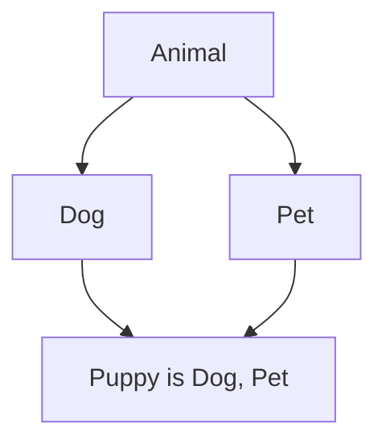

**In simple words:** Solidity lets one contract inherit from **several parent contracts** at once, written as `contract C is A, B`. The child gets the state variables and functions of all its parents. Solidity copies code from the parents into the child and uses the **C3 linearization** rule to decide which parent wins when two parents have the same function. <Cite id="solidity-docs-inheritance" />

**Rules to remember:**

1. List parents from "most base-like" to "most derived". In `is Dog, Pet`, `Pet` is the most derived parent. A wrong order gives a compile error.
2. A function that a child may change is marked `virtual` in the parent, and the child marks it `override`.
3. If two parents define the same function, the child must write `override(Dog, Pet)` and say so explicitly.
4. `super.f()` calls the next contract in the linearized order, not necessarily the direct parent. <Cite id="solidity-gfg-inheritance" />

**Example:**

```solidity
// SPDX-License-Identifier: MIT
pragma solidity ^0.8.0;

contract Animal {
    function sound() public pure virtual returns (string memory) {
        return "some sound";
    }
}

contract Dog is Animal {
    function sound() public pure virtual override returns (string memory) {
        return "bark";
    }
}

contract Pet is Animal {
    function sound() public pure virtual override returns (string memory) {
        return "purr";
    }
}

// Order matters: the right-most parent (Pet) is the most derived.
contract Puppy is Dog, Pet {
    function sound() public pure override(Dog, Pet) returns (string memory) {
        return super.sound();
    }
}
```

**Line by line:** `Animal` is the base with a default `sound()`. `Dog` and `Pet` both inherit `Animal` and replace `sound()`. `Puppy` inherits both, so it must say `override(Dog, Pet)`. `super.sound()` goes to the next contract in the order.



<Box kind="verify">

Call `Puppy.sound()`. Linearized order is Puppy, Pet, Dog, Animal. `super.sound()` runs `Pet.sound()`, which does not call `super`, so it returns "purr". Swapping to `is Pet, Dog` would return "bark". The code was compiled with solc 0.8.26 without errors.

</Box>

**Conclusion:** Solidity supports multiple inheritance with the `is` list, `virtual` and `override`, and a fixed linearization order, which avoids the ambiguity of the diamond problem.
