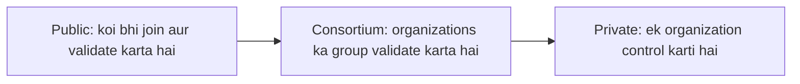

**In simple words:** teeno types ka fark hai ki **kaun join kar sakta hai, kaun blocks validate karta hai, aur kaun data padh sakta hai**. Public sabke liye khula hai, private ek organization ka hota hai, aur consortium kai organizations ka group chalata hai. <Cite id="blockchain-fundamentals-gfg-types" />

**Public blockchain:** koi bhi bina permission join kar sakta hai, padh sakta hai, transactions bhej sakta hai aur consensus mein hissa le sakta hai. Consensus PoW ya PoS se. Examples: Bitcoin, Ethereum.

**Private blockchain:** ek organization control karti hai ki kaun join karega aur kaun validate karega. Sirf invited users padh ya likh sakte hain. Fast aur private, lekin kam decentralised. Examples: company ka internal ledger, ek firm ke andar Hyperledger Fabric. <Cite id="private-blockchain-gfg-private" />

**Consortium (federated) blockchain:** pehle se chune hue organizations ka group, jaise kai banks, control share karta hai. Har ek validator nodes chalata hai. Read access public ya limited ho sakta hai. Examples: banks ke liye R3 Corda, Hyperledger Fabric networks, Quorum. <Cite id="private-blockchain-gfg-consortium" /> <Cite id="private-blockchain-fabric-whatis" />

| Point | Public | Private | Consortium |
|---|---|---|---|
| Access | Sabke liye khula (permissionless) | Invite only (permissioned) | Permissioned, approved members |
| Control | Kisi ka nahi | Ek organization | Organizations ka group |
| Decentralisation | Sabse zyada | Sabse kam | Partial |
| Consensus | PoW, PoS | Raft, PBFT, simple voting | PBFT, Raft, IBFT |
| Speed | Slow (kam transactions per second) | Fast | Fast |
| Transparency | Sab sab dekhte hain | Sirf members | Members, ya limited public view |
| Energy and cost | PoW mein zyada | Kam | Kam |
| Trust needed | Participants pe trust nahi chahiye | Owner pe trust | Consortium members ke beech trust |
| Examples | Bitcoin, Ethereum | Internal company ledger | Corda, Fabric, Quorum |

**Use cases:** public cryptocurrency aur open dApps ke liye; private internal audit aur records ke liye; consortium banking, supply chain aur trade finance ke liye jahan kai companies ko ek trusted ledger share karna hai. <Cite id="blockchain-fundamentals-nist-8202" />

**Conclusion:** openness chahiye to public, control aur speed chahiye to private, aur businesses ke beech shared control chahiye to consortium.

Exam mein English mein likho: "Public blockchains are permissionless, private blockchains are controlled by one organization, and consortium blockchains are controlled by a group."
