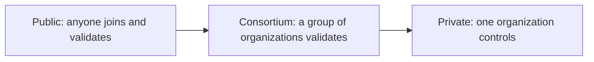

**In simple words:** the three types differ in **who can join, who can validate blocks, and who can read the data**. Public is open to everyone, private is owned by one organization, and consortium is run by a group of organizations. <Cite id="blockchain-fundamentals-gfg-types" />

**Public blockchain:** anyone can join, read, send transactions and take part in consensus without permission. Consensus is by PoW or PoS. Examples: Bitcoin, Ethereum.

**Private blockchain:** one organization controls who joins and who validates. Only invited users can read or write. Faster and private, but less decentralised. Examples: an internal company ledger, Hyperledger Fabric in a single firm. <Cite id="private-blockchain-gfg-private" />

**Consortium (federated) blockchain:** a group of pre-selected organizations, for example several banks, share control. Each runs validator nodes. Read access may be public or limited. Examples: R3 Corda for banks, Hyperledger Fabric networks, Quorum. <Cite id="private-blockchain-gfg-consortium" /> <Cite id="private-blockchain-fabric-whatis" />

| Point | Public | Private | Consortium |
|---|---|---|---|
| Access | Open to all (permissionless) | Invite only (permissioned) | Permissioned, approved members |
| Control | No one owns it | One organization | Group of organizations |
| Decentralisation | Highest | Lowest | Partial |
| Consensus | PoW, PoS | Raft, PBFT, simple voting | PBFT, Raft, IBFT |
| Speed | Slow (low transactions per second) | Fast | Fast |
| Transparency | Everyone sees all data | Only members | Members, or limited public view |
| Energy and cost | High for PoW | Low | Low |
| Trust needed | Not needed in participants | Trust in the owner | Trust among consortium members |
| Examples | Bitcoin, Ethereum | Internal company ledger | Corda, Fabric, Quorum |

**Use cases:** public for cryptocurrency and open dApps; private for internal audit and records; consortium for banking, supply chain and trade finance where several companies must share one trusted ledger. <Cite id="blockchain-fundamentals-nist-8202" />

**Conclusion:** choose public for openness, private for control and speed, and consortium for shared control between businesses.
