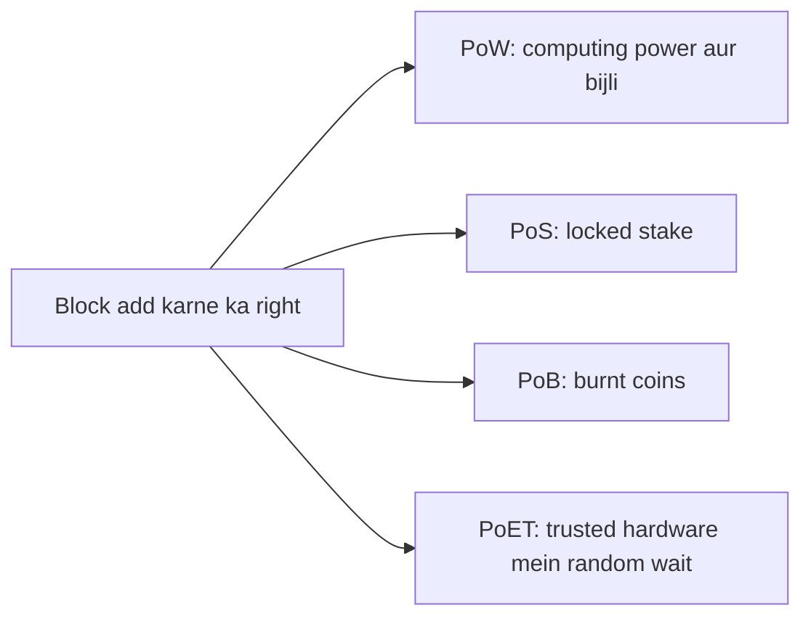

**In simple words:** consensus algorithm decide karta hai ki **agla block kaun add karega** aur sabko uspe agree karata hai. Chaaron mein fark ye hai ki jeetne ke liye node ko kya "dena" padta hai: computing power (PoW), locked coins (PoS), burnt coins (PoB) ya random waiting time (PoET). <Cite id="consensus-mining-gfg-consensus" />

**PoW (Proof of Work):** miners alag alag nonce se block header ko baar baar hash karte hain jab tak hash target se chhota na aa jaye. Jo pehle dhoondhta hai wo block add karta hai aur reward pata hai. Bitcoin mein use hota hai. Secure hai, lekin bahut energy lagti hai. <Cite id="consensus-mining-wiki-pow" />

**PoS (Proof of Stake):** validators coins lock ("stake") karte hain. Protocol ek validator ko, kuch random aur stake ke weight ke hisaab se, block propose karne ke liye chunta hai, baaki attest karte hain. Cheating pe stake kat sakta hai ("slashing"). Ethereum mein 2022 se. <Cite id="consensus-mining-eth-pos" />

**PoB (Proof of Burn):** node coins ek aise address pe bhejta hai jise kharch nahi kiya ja sakta. Burn karna commitment dikhata hai, aur jitna zyada burn, utna chunne ka chance. Bijli ki jagah coins ka cost. <Cite id="consensus-mining-btcwiki-pob" />

**PoET (Proof of Elapsed Time):** har node trusted hardware (Intel SGX) se random wait time maangta hai. Jis node ka timer pehle khatam hota hai wo agla block banata hai, aur hardware prove karta hai ki usne sach mein wait kiya. Hyperledger Sawtooth mein, mainly permissioned networks mein. <Cite id="consensus-mining-gfg-crypto-consensus" />

| Point | PoW | PoS | PoB | PoET |
|---|---|---|---|---|
| Winner kaise chuna jaata hai | Hash puzzle pehle solve kare | Stake size plus randomness | Burnt coins ki amount | Sabse chhota random wait time |
| Resource | Computing power | Locked coins | Burnt coins | Trusted hardware (SGX) |
| Energy use | Bahut zyada | Bahut kam | Kam | Bahut kam |
| Speed | Slow | Tez | Medium | Fast |
| Main risk | 51% attack; energy waste | Ameer aur ameer; "nothing at stake" ki chinta | Coins hamesha ke liye gaye; ameer zyada burn kar sakta hai | Chip maker pe trust; hardware flaws |
| Network type | Public | Public | Public | Mostly permissioned |
| Example | Bitcoin | Ethereum | Slimcoin | Hyperledger Sawtooth |

**Conclusion:** PoW sabse proven lekin mehnga hai, PoS aur PoET energy bachate hain, PoB beech mein hai. Sahi choice trust model aur chahiye speed pe depend karti hai.

Exam mein English mein likho: "PoW uses computing power, PoS uses stake, PoB uses burnt coins and PoET uses a random waiting time."
