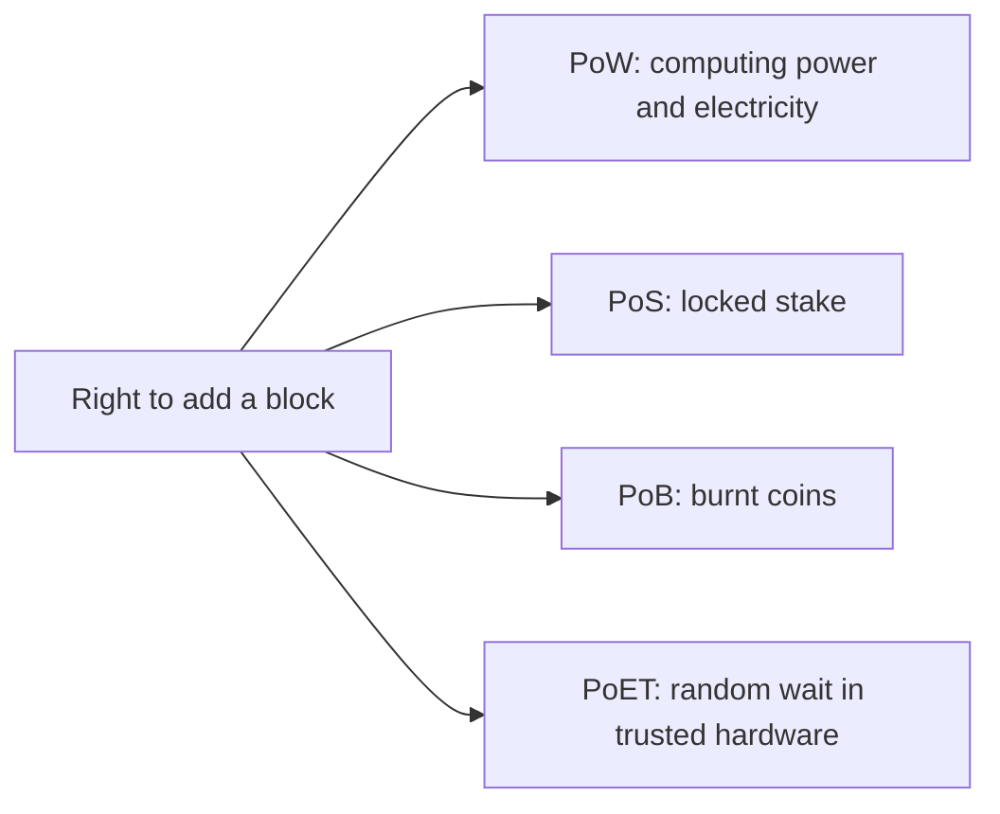

**In simple words:** a consensus algorithm decides **who gets to add the next block** and makes everyone agree on it. The four differ in what a node must "give up" to win the right: computing power (PoW), locked coins (PoS), burnt coins (PoB) or a random waiting time (PoET). <Cite id="consensus-mining-gfg-consensus" />

**PoW (Proof of Work):** miners repeatedly hash the block header with different nonces until the hash is below the target. The first to find it adds the block and gets the reward. Used by Bitcoin. Secure, but uses huge energy. <Cite id="consensus-mining-wiki-pow" />

**PoS (Proof of Stake):** validators lock ("stake") coins. The protocol picks a validator, partly at random and weighted by stake, to propose a block, and others attest to it. Cheating can lose the stake ("slashing"). Used by Ethereum since 2022. <Cite id="consensus-mining-eth-pos" />

**PoB (Proof of Burn):** a node sends coins to an address that cannot be spent. Burning shows commitment, and the chance to be picked grows with the amount burnt. The cost is coins instead of electricity. <Cite id="consensus-mining-btcwiki-pob" />

**PoET (Proof of Elapsed Time):** every node asks trusted hardware (Intel SGX) for a random wait time. The node whose timer ends first creates the next block, and the hardware proves it really waited. Used in Hyperledger Sawtooth, mainly in permissioned networks. <Cite id="consensus-mining-gfg-crypto-consensus" />

| Point | PoW | PoS | PoB | PoET |
|---|---|---|---|---|
| Winner chosen by | First to solve hash puzzle | Stake size plus randomness | Amount of coins burnt | Shortest random wait time |
| Resource used | Computing power | Locked coins | Burnt coins | Trusted hardware (SGX) |
| Energy use | Very high | Very low | Low | Very low |
| Speed | Slow | Faster | Medium | Fast |
| Main risk | 51% attack; energy waste | Rich get richer; "nothing at stake" worries | Coins are lost forever; rich can burn more | Depends on trust in the chip maker; hardware flaws |
| Network type | Public | Public | Public | Mostly permissioned |
| Example | Bitcoin | Ethereum | Slimcoin | Hyperledger Sawtooth |

**Conclusion:** PoW is the most proven but costly, PoS and PoET save energy, and PoB sits in between. The best choice depends on the trust model and the speed needed.
