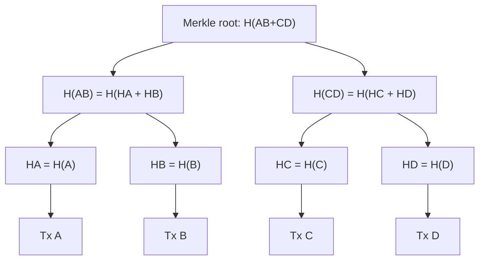

**In simple words:** **Merkle tree** (hash tree) hashes ka binary tree hai. Har leaf ek transaction ka hash hai, har parent apne do children ko jodkar uska hash hai, aur sabse upar ka ek hash **Merkle root** hai. Root block header mein store hota hai aur block ke saare transactions ko represent karta hai. <Cite id="block-structure-merkle-gfg-merkle" /> <Cite id="block-structure-merkle-wiki-merkle" />

**Kyun zaroori hai:**

1. **Tamper detection:** ek transaction badlo to uska hash badlega, phir root tak har parent badlega.
2. **Chhota header:** header mein sirf 32 bytes (root) hote hain, saare transactions nahi.
3. **Quick proof (SPV):** light client kuch hi hashes se check kar leta hai ki transaction block mein hai, poora block download kiye bina. <Cite id="blockchain-fundamentals-nakamoto" loc="§8" /> <Cite id="block-structure-merkle-mb-ch11" />

**Kaise banta hai:**

1. Har transaction ko hash karo, ye leaves hain.
2. Leaves ko jodiyon mein jodo, har jodi ka hash lo, ye agla level hai.
3. Agar kisi level pe nodes odd hain to Bitcoin aakhri node ko duplicate karke jodi bana leta hai.
4. Tab tak repeat karo jab tak ek hash bache: Merkle root.

<Sum>

<Given>

Block mein chaar transactions A, B, C, D. Hash ko $H(\cdot)$ likho aur chhote labels use karo: $H_A = H(A)$, aur aise hi.

</Given>

<Find>

Merkle root, aur light client kaise prove karta hai ki transaction C block mein hai.

</Find>

<Steps>

1. **Leaves.** $H_A = H(A)$, $H_B = H(B)$, $H_C = H(C)$, $H_D = H(D)$. *Reason: har leaf ek transaction ka hash hai.*
2. **Level 1.** $H_{AB} = H(H_A \,\|\, H_B)$ aur $H_{CD} = H(H_C \,\|\, H_D)$. *Reason: har parent apne do children ko jodkar hash karta hai.*
3. **Root.** $H_{ABCD} = H(H_{AB} \,\|\, H_{CD})$. *Reason: do nodes bache, to unhe ek baar aur jodte hain.*
4. **C ka proof.** Client ko sirf $H_D$ (C ka sibling) aur $H_{AB}$ (ek level upar ka sibling) chahiye: $H_{CD} = H(H_C \,\|\, H_D)$, phir $H(H_{AB} \,\|\, H_{CD})$ header ke root ke barabar hona chahiye. *Reason: proof har level ka sibling hash hota hai.*

</Steps>

<Answer>

Merkle root $= H_{ABCD} = H\big(H(H_A\|H_B)\,\|\,H(H_C\|H_D)\big)$. C ka proof do hashes ka hai, $H_D$ aur $H_{AB}$.

</Answer>

<Box kind="verify">

Hash count: $4 + 2 + 1 = 7$ hashes, yaani $n = 4$ ke liye $2n - 1$. Proof size: $\log_2 4 = 2$ hashes, step 4 se match. 1000 transactions ke liye bhi proof sirf $\lceil \log_2 1000 \rceil = 10$ hashes (lagbhag 320 bytes) hota. Agar C ko C' kar do, to $H_C$, $H_{CD}$ aur root sab badal jaate hain, aur header check fail ho jaata hai.

</Box>

</Sum>

**Odd number:** paanch transactions A se E ho to E ko khud ke saath jodte hain: $H_{EE} = H(H_E \| H_E)$. Level 1 mein teen nodes bante hain, to agle level pe $H_{EE}$ phir duplicate hota hai.

**Uses:** Bitcoin block headers, Ethereum (Merkle Patricia tries), Git, IPFS. <Cite id="block-structure-merkle-lmab-merkle" />

**Conclusion:** Merkle tree block ka tamper-proof summary deta hai aur membership ke fast, chhote proofs.

Exam mein English mein likho: "The Merkle root is the single hash at the top of the tree and it summarises all transactions in the block."
