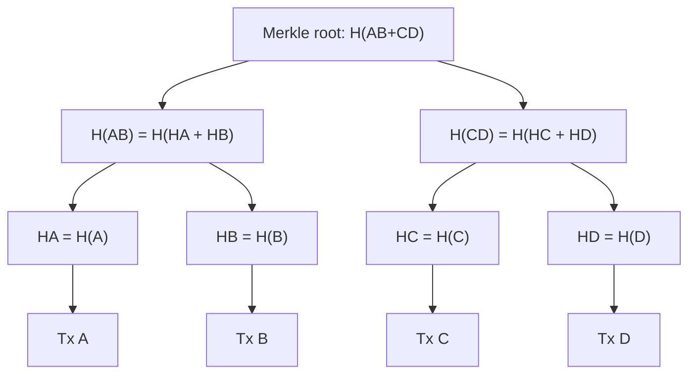

**In simple words:** a **Merkle tree** (hash tree) is a binary tree of hashes. Each leaf is the hash of one transaction, each parent is the hash of its two children joined together, and the single hash at the top is the **Merkle root**. The root is stored in the block header and stands for every transaction in the block. <Cite id="block-structure-merkle-gfg-merkle" /> <Cite id="block-structure-merkle-wiki-merkle" />

**Why it is needed:**

1. **Tamper detection:** change one transaction and its hash changes, then every parent up to the root changes.
2. **Small header:** the header holds only 32 bytes (the root), not all transactions.
3. **Quick proof (SPV):** a light client can check that a transaction is in a block with only a few hashes, not the whole block. <Cite id="blockchain-fundamentals-nakamoto" loc="§8" /> <Cite id="block-structure-merkle-mb-ch11" />

**How it is built:**

1. Hash every transaction to get the leaves.
2. Join leaves in pairs, hash each pair to get the next level.
3. If a level has an odd number of nodes, Bitcoin duplicates the last one to make a pair.
4. Repeat until one hash is left: the Merkle root.

<Sum>

<Given>

Four transactions A, B, C, D in a block. Write $H(\cdot)$ for the hash and use short labels: $H_A = H(A)$, and so on.

</Given>

<Find>

the Merkle root, and how a light client proves that transaction C is in the block.

</Find>

<Steps>

1. **Leaves.** $H_A = H(A)$, $H_B = H(B)$, $H_C = H(C)$, $H_D = H(D)$. *Reason: each leaf is the hash of one transaction.*
2. **Level 1.** $H_{AB} = H(H_A \,\|\, H_B)$ and $H_{CD} = H(H_C \,\|\, H_D)$. *Reason: each parent hashes its two children joined together.*
3. **Root.** $H_{ABCD} = H(H_{AB} \,\|\, H_{CD})$. *Reason: two nodes remain, so they are paired once more.*
4. **Proof for C.** The client needs only $H_D$ (C's sibling) and $H_{AB}$ (sibling one level up): $H_{CD} = H(H_C \,\|\, H_D)$, then $H(H_{AB} \,\|\, H_{CD})$ must equal the root in the header. *Reason: the proof is the sibling hash at each level.*

</Steps>

<Answer>

Merkle root $= H_{ABCD} = H\big(H(H_A\|H_B)\,\|\,H(H_C\|H_D)\big)$. The proof for C is two hashes, $H_D$ and $H_{AB}$.

</Answer>

<Box kind="verify">

Hash count: $4 + 2 + 1 = 7$ hashes, which is $2n - 1$ for $n = 4$. Proof size: $\log_2 4 = 2$ hashes, matching step 4. For 1000 transactions the proof would still be only $\lceil \log_2 1000 \rceil = 10$ hashes, about 320 bytes. If C is altered to C', $H_C$, $H_{CD}$ and the root all change, so the header check fails.

</Box>

</Sum>

**Odd number:** with five transactions A to E, E is paired with itself: $H_{EE} = H(H_E \| H_E)$. Level 1 then has three nodes, so $H_{EE}$ is duplicated again at the next level.

**Uses:** Bitcoin block headers, Ethereum (Merkle Patricia tries), Git, IPFS. <Cite id="block-structure-merkle-lmab-merkle" />

**Conclusion:** a Merkle tree gives a tamper-proof summary of a block and fast, tiny proofs of membership.
