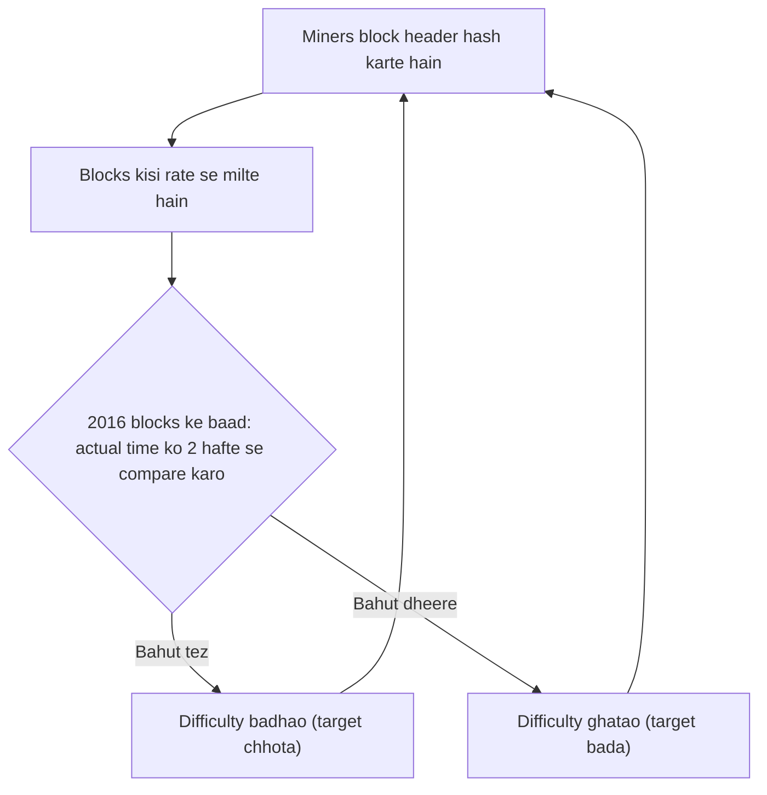

**In simple words:** proof of work mein **mining difficulty** batati hai ki valid block hash dhoondhna kitna mushkil hai. Miner ko block header ka aisa hash dhoondhna hota hai jo ek **target number se chhota** ho. Target jitna chhota, puzzle utna mushkil. Network difficulty adjust karta rehta hai taaki blocks steady rate se aate rahein (Bitcoin: har 10 minute mein ek block). <Cite id="bitcoin-btcwiki-difficulty" />

**Kyun zaroori hai:** miners aate jaate hain aur hardware tez hota jaata hai. Adjust na karein to jab bahut miners judenge blocks bahut jaldi aayenge, aur jab chale jayenge to bahut dheere. <Cite id="blockchain-fundamentals-nakamoto" loc="§4" />

**Kaise kaam karta hai:**

1. Miner header ka **nonce** badalta hai, SHA-256 (do baar) se hash karta hai, aur check karta hai ki $\text{hash} < \text{target}$. Hash effectively random hota hai, isliye bas baar baar try karna hi raasta hai.
2. Ek try ke safal hone ka chance $\text{target} / 2^{256}$ hai, to expected tries $2^{256} / \text{target}$.
3. **Difficulty** sabse easy allowed target ke relative define hoti hai:

$$
\text{Difficulty} = \frac{\text{target}_{max}}{\text{target}}, \qquad \text{expected hashes} \approx \text{Difficulty} \times 2^{32}
$$

4. **Har 2016 blocks pe retarget** (10 minute per block pe lagbhag 2 hafte):

$$
\text{new difficulty} = \text{old difficulty} \times \frac{2016 \times 10 \text{ min}}{\text{actual time taken}}
$$

Pichle 2016 blocks bahut jaldi mile to difficulty badhti hai; bahut dheere mile to ghatti hai. Ek baar mein change 4 guna tak limited hai. <Cite id="bitcoin-mb-ch12-mining" />

**Easy example (leading zeros):** agar valid hash 4 zero hex digits se shuru hona chahiye, to har hex digit ke zero hone ka chance 1/16 hai, to ek try ki success probability $1/16^4$. Expected tries $= 16^4 = 65{,}536$. Har extra zero se work 16 guna.

<Sum>

<Given>

Difficulty $= 1{,}000{,}000$. Miner ke paas 1 TH/s $= 10^{12}$ hashes per second hai. Pichle 2016 blocks target 14 din ki jagah 12 din mein bane.

</Given>

<Find>

(a) ek block ke liye expected hashes, (b) miner ka expected time, (c) nayi difficulty.

</Find>

<Steps>

1. **Expected hashes.** $10^6 \times 2^{32} = 10^6 \times 4{,}294{,}967{,}296 \approx 4.29 \times 10^{15}$. *Reason: expected hashes = difficulty times $2^{32}$.*
2. **Expected time.** $4.29 \times 10^{15} \div 10^{12} = 4295$ seconds, lagbhag 71.6 minutes. *Reason: time = work divided by hash rate.*
3. **Nayi difficulty.** $10^6 \times \dfrac{14}{12} = 1{,}166{,}667$ (rounded). *Reason: blocks plan se jaldi aaye, to puzzle target time aur actual time ke ratio mein mushkil kiya jaata hai.*

</Steps>

<Answer>

(a) lagbhag $4.29 \times 10^{15}$ hashes; (b) lagbhag 71.6 minutes; (c) nayi difficulty lagbhag 1,166,667.

</Answer>

<Box kind="verify">

Network check: poore network ko is difficulty pe har 10 minute mein ek block ke liye $4.29 \times 10^{15} \div 600\ \text{s} \approx 7.16 \times 10^{12}$ H/s chahiye, to 1 TH/s wale miner ke paas uska lagbhag $1/7.16 \approx 14\%$ hai, aur wo lagbhag $600 \div 0.14 \approx 4295$ s mein ek block jeetega. Ye step 2 se match karta hai. (c) ke liye: 12 din, 14 din se kam hain, to ratio $14/12 > 1$ hai aur difficulty badhni chahiye, jo badhi.

</Box>

</Sum>

**Conclusion:** difficulty total mining power kuch bhi ho, block rate ko stable rakhti hai aur attack ko mehnga banati hai. <Cite id="bitcoin-gfg-pow" /> <Cite id="bitcoin-lmab-mining" />

Exam mein English mein likho: "Mining difficulty is adjusted every 2016 blocks so that a block is found about every 10 minutes."
