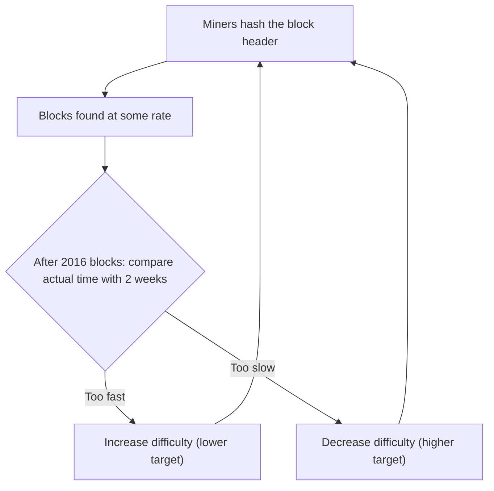

**In simple words:** in proof of work, **mining difficulty** says how hard it is to find a valid block hash. A miner must find a hash of the block header that is **below a target number**. The lower the target, the harder the puzzle. The network adjusts difficulty so blocks keep coming at a steady rate (Bitcoin: one block per 10 minutes). <Cite id="bitcoin-btcwiki-difficulty" />

**Why it is needed:** miners join and leave and hardware gets faster. Without adjustment, blocks would come too fast when many miners join, or too slowly when they leave. <Cite id="blockchain-fundamentals-nakamoto" loc="§4" />

**How it works:**

1. The miner changes the **nonce** in the header, hashes it with SHA-256 (twice), and checks whether $\text{hash} < \text{target}$. A hash is effectively random, so the only way is to try again and again.
2. The chance that one try succeeds is $\text{target} / 2^{256}$, so the expected number of tries is $2^{256} / \text{target}$.
3. **Difficulty** is defined relative to the easiest allowed target:

$$
\text{Difficulty} = \frac{\text{target}_{max}}{\text{target}}, \qquad \text{expected hashes} \approx \text{Difficulty} \times 2^{32}
$$

4. **Retarget every 2016 blocks** (about 2 weeks at 10 minutes per block):

$$
\text{new difficulty} = \text{old difficulty} \times \frac{2016 \times 10 \text{ min}}{\text{actual time taken}}
$$

If the last 2016 blocks were found too quickly, difficulty goes up; too slowly, it goes down. A single change is limited to a factor of 4. <Cite id="bitcoin-mb-ch12-mining" />

**Easy example (leading zeros):** if a valid hash must start with 4 zero hex digits, each hex digit has a 1 in 16 chance of being zero, so a try succeeds with probability $1/16^4$. Expected tries $= 16^4 = 65{,}536$. Each extra zero multiplies the work by 16.

<Sum>

<Given>

Difficulty $= 1{,}000{,}000$. A miner has 1 TH/s $= 10^{12}$ hashes per second. The last 2016 blocks took 12 days instead of the target 14 days.

</Given>

<Find>

(a) the expected hashes for one block, (b) the miner's expected time, (c) the new difficulty.

</Find>

<Steps>

1. **Expected hashes.** $10^6 \times 2^{32} = 10^6 \times 4{,}294{,}967{,}296 \approx 4.29 \times 10^{15}$. *Reason: expected hashes equal difficulty times $2^{32}$.*
2. **Expected time.** $4.29 \times 10^{15} \div 10^{12} = 4295$ seconds, about 71.6 minutes. *Reason: time equals work divided by hash rate.*
3. **New difficulty.** $10^6 \times \dfrac{14}{12} = 1{,}166{,}667$ (rounded). *Reason: blocks came faster than planned, so the puzzle is made harder in the ratio target time to actual time.*

</Steps>

<Answer>

(a) about $4.29 \times 10^{15}$ hashes; (b) about 71.6 minutes; (c) new difficulty about 1,166,667.

</Answer>

<Box kind="verify">

Network check: the whole network needs $4.29 \times 10^{15} \div 600\ \text{s} \approx 7.16 \times 10^{12}$ H/s to find a block every 10 minutes at this difficulty, so the 1 TH/s miner owns about $1/7.16 \approx 14\%$ of that, and it should win a block about once per $600 \div 0.14 \approx 4295$ s. This matches step 2. For (c): 12 days is shorter than 14, so the ratio $14/12 > 1$ and difficulty must rise, as it did.

</Box>

</Sum>

**Conclusion:** difficulty keeps the block rate stable whatever the total mining power, and it makes an attack costly. <Cite id="bitcoin-gfg-pow" /> <Cite id="bitcoin-lmab-mining" />
