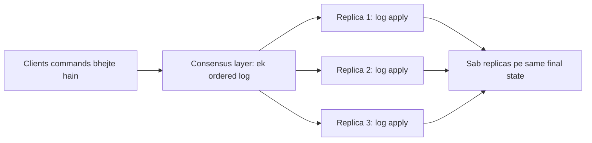

**In simple words:** **state machine replication (SMR)** kai servers ko same state mein rakhta hai: har server ko same program ki copy dete hain aur sabko **same commands same order mein** dete hain. Copies deterministic hon to sab same state pe pahunchti hain, aur ek server fail ho jaye to baaki chalte rehte hain. <Cite id="smart-contracts-wiki-smr" /> <Cite id="smart-contracts-schneider-1990" />

**Key ideas:**

- **State machine:** ek program jiski ek current state hoti hai aur ek rule jo (state, command) se nayi state banata hai, jaise bank balance ya key-value store.
- **Deterministic:** same state aur command hamesha same nayi state dete hain (random numbers nahi, local clock nahi).
- **Replication:** wahi machine $n$ servers pe chalao.
- **Total order:** sab replicas ko commands ke order pe agree karna padta hai. Ye agreement **consensus protocol** (Paxos, Raft, PBFT) ka kaam hai. <Cite id="bft-paxos-raft-wiki-consensus" />

**Kaise kaam karta hai:**

1. Client system ko command bhejta hai.
2. Consensus protocol command ko shared log mein agli position pe rakhta hai.
3. Har replica log entries ko ek ek karke, log ke order mein apply karta hai.
4. Ab sab replicas ki state same hai; koi bhi read ka jawab de sakta hai aur koi crash ho to doosra uski jagah le sakta hai.

**Example (bank account):** teen replicas R1, R2, R3 sab balance 100 se shuru karte hain. Agreed log: (1) deposit 50, (2) withdraw 30. Har replica order mein apply karta hai: $100 + 50 = 150$, phir $150 - 30 = 120$. Teeno 120 dikhate hain. Agar R2 step 1 ke baad crash ho aur baad mein restart ho, to wo doosron se log replay karke 120 pe pahunch jaata hai. Agar kisi replica pe order alag hota (pehle withdraw 30, phir deposit 50), to yahan final value phir bhi 120 aati, lekin "balance amount se kam ho to reject" jaisa rule ho to alag order alag result de sakta hai, isliye order pe agreement zaroori hai.

**Fault tolerance:** $f$ crashed servers sehne ke liye $n \ge 2f + 1$ replicas chahiye (Paxos, Raft). $f$ Byzantine (jhooth bolne wale) servers ke liye $n \ge 3f + 1$ (PBFT). <Cite id="bft-paxos-raft-pbft-paper" />

**Blockchain se link:** blockchain state machine replication hi hai. Har node ek replica hai, transactions commands hain, blocks order dete hain, aur rules (jaise EVM) deterministic state transition hain.

**Conclusion:** SMR deterministic program aur command order pe agreement ko jodkar fault tolerance aur consistency deta hai. <Cite id="bft-paxos-raft-paxos-simple" />

Exam mein English mein likho: "In state machine replication, all replicas start in the same state and apply the same commands in the same order, so they end in the same state."
