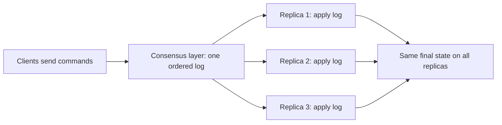

**In simple words:** **state machine replication (SMR)** keeps many servers in the same state by giving each a copy of the same program and feeding all copies the **same commands in the same order**. If the copies are deterministic, they end in the same state, so if one server fails the others carry on. <Cite id="smart-contracts-wiki-smr" /> <Cite id="smart-contracts-schneider-1990" />

**Key ideas:**

- **State machine:** a program with a current state and a rule that takes (state, command) to a new state, for example a bank balance or a key-value store.
- **Deterministic:** the same state and command always give the same new state (no random numbers, no local clock).
- **Replication:** run the same machine on $n$ servers.
- **Total order:** all replicas must agree on the order of commands. This agreement is the job of a **consensus protocol** (Paxos, Raft, PBFT). <Cite id="bft-paxos-raft-wiki-consensus" />

**How it works:**

1. A client sends a command to the system.
2. The consensus protocol puts the command at the next position in a shared log.
3. Every replica applies the log entries one by one, in log order.
4. All replicas now hold the same state; any can answer a read, and any can take over if another crashes.

**Example (bank account):** three replicas R1, R2, R3 all start with balance 100. The agreed log is: (1) deposit 50, (2) withdraw 30. Each replica applies them in order: $100 + 50 = 150$, then $150 - 30 = 120$. All three show 120. If R2 crashes after step 1 and later restarts, it replays the log from the other replicas and reaches 120 as well. If the order differed on one replica (withdraw 30 first, then deposit 50), the final value would still be 120 here, but with a rule such as "reject if balance is below the amount" different orders could give different results, which is why the order must be agreed.

**Fault tolerance:** to survive $f$ crashed servers you need $n \ge 2f + 1$ replicas (Paxos, Raft). To survive $f$ Byzantine (lying) servers you need $n \ge 3f + 1$ (PBFT). <Cite id="bft-paxos-raft-pbft-paper" />

**Link to blockchain:** a blockchain is state machine replication. Each node is a replica, transactions are commands, blocks give the order, and the rules (for example the EVM) are the deterministic state transition.

**Conclusion:** SMR gives fault tolerance and consistency by combining a deterministic program with agreement on command order. <Cite id="bft-paxos-raft-paxos-simple" />
